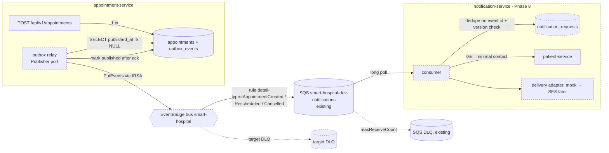

# ADR-001: Notification communication architecture for appointment bookings

| Field | Value |
|---|---|
| ADR ID | ADR-001 |
| Title | Notification communication architecture for appointment bookings |
| **Status** | **Proposed** — not accepted. Stays Proposed until approved by the accountable architect / governance body (§19) |
| Date drafted | 2026-11-02 |
| Scope | appointment-service (producer), notification-service (planned Phase 8 consumer), patient-service (contact lookup), smart-hospital-infra, smart-hospital-gitops |
| Inputs | [`cross-repository-discovery.md`](cross-repository-discovery.md) (`F-xx`), [`dependency-mapping.md`](dependency-mapping.md) (`D-xx`), [`architecture-options-tradeoff.md`](architecture-options-tradeoff.md) (`C-xx`, `R-x`) |
| Supersedes / superseded by | — / — |

**Evidence labels used throughout:**
- **[Fact]** is verified in a repository file (cited as `repo:path[:lines]`, on `main` at the time of the split).
- **[Assumption]** is accepted for planning but not verified.
- **[Hypothesis]** is plausible but needs validation.
- **[Recommendation]** is the proposal under review.

This ADR changes no code or infrastructure and implements nothing. The source reports are on unmerged branches;
the links resolve once they merge.

---

## 1. Context and background

- [Fact] The system is a development demo of eight planned microservices. Notification is Phase 8, and its rules are
  "transport-independent, start with a mock adapter and a durable request/status model; add a broker only when
  explicitly requested and justified" (`smart-hospital-architecture:AGENTS.md:28,35`).
- [Fact] Six services are implemented. Encounter and notification have no repository or code (discovery §1, F-11).
- [Fact] The business need is to notify a patient after a successful booking without making booking depend on
  notification (problem statement in the trade-off report §Problem).

## 2. Current-state evidence

| ID | Verified fact | Evidence |
|---|---|---|
| E-1 | [Fact] Book, reschedule and cancel insert an `outbox_events` row **in the same transaction** as the appointment change; a failure rolls back both | `appointment-service:app/services/appointment_service.py:188-207` (`_save`); `README.md:203-206` |
| E-2 | [Fact] Events: `AppointmentCreated`, `AppointmentRescheduled`, `AppointmentCancelled`. Check-in, complete and no-show emit none | `appointment-service:app/domain/appointments.py`; `README.md:203-205` |
| E-3 | [Fact] Payload: `event_type, appointment_id, patient_id, provider_id, facility_id, starts_at, ends_at, status, version, occurred_at`. IDs and times only; no contact or clinical data; no `schema_version` | `appointment_service.py:209-230`; `app/models/outbox_event.py` docstring |
| E-4 | [Fact] The outbox is indexed for a relay (`published_at`, `occurred_at`), but **no relay, broker client or consumer exists in any repository** | `app/models/outbox_event.py:19-31`; repo search for rabbitmq, amqp, eventbridge, kafka: none (F-09) |
| E-5 | [Fact] An SQS queue `smart-hospital-dev-notifications` + DLQ exists in Terraform: SSE on, long polling 20 s, redrive after `max_receive_count`, DLQ retention 14 days, TLS-only policy | `smart-hospital-infra:infra/terraform/modules/sqs/main.tf:1-24,51`; `environments/dev/main.tf:127-132` |
| E-6 | [Fact] notification-service IAM grants for SQS send/receive/delete and SES send are defined, but no workload uses them | `smart-hospital-infra:infra/terraform/environments/dev/main.tf:28-45,161` |
| E-7 | [Fact] The SES identity is created only when a custom domain exists, and dev has `hosted_zone_name = null` | `dev/main.tf:17,134-136`; `dev/terraform.tfvars:111,135` |
| E-8 | [Fact] appointment stores only `patient_id` (UUID, no FK). No service has a patient-service client | `appointment-service:app/models/appointment.py:21,49`; D-06, `dependency-mapping.md` §8.2 |
| E-9 | [Fact] Service-to-service calls forward the end user's bearer token; there is no service identity | `scheduling-service:app/clients/facility_client.py:66-70`; `appointment-service:app/clients/scheduling_client.py:82-85`; F-08 |
| E-10 | [Fact] Every service verifies tokens with one shared HS256 key | `smart-hospital-infra:modules/secrets/main.tf:34-49`; `smart-hospital-gitops:deploy/helm/microservice/templates/_externalsecret.tpl:44-51`; F-07 |
| E-11 | [Fact] Single-AZ RDS on `db.t3.micro`, spot-only nodes and `replicaCount: 1` in dev | `dev/terraform.tfvars`; `deploy/helm/*/dev-values.yaml`; F-18 |
| E-12 | [Fact] Rules: generic, non-clinical notification content; idempotency for repeatable notification processing; ask before adding brokers or real email/SMS | `Smart_Hospital_Repository_Rules.md:34,49,50`; `AGENTS.md:45,60` |

**Current behaviour:** a booking durably records `AppointmentCreated`, and **no notification is sent**.

## 3. Problem statement

- **Business:** patients aren't told about bookings, reschedules or cancellations. Missed or duplicate messages
  erode trust.
- **Technical:**
  - events are produced but never delivered (E-4);
  - nothing resolves patient contact details (E-8);
  - there is no service identity for a background consumer (E-9);
  - a design is needed that keeps booking available when notification is down and doesn't add uncontrolled
    operational load.

## 4. Decision drivers

| ID | Driver | Source |
|---|---|---|
| R1 | Booking succeeds when notification is down or slow | Problem statement |
| R2 | No committed event is lost: each is delivered or ends in a reviewable dead-letter store | Trade-off §2 |
| R3 | Duplicate-safe processing (at-least-once delivery with idempotent handling) | E-12 |
| R4 | Minimum data in events (IDs only); contact details looked up at send time; generic text | E-3, E-12 |
| R5 | Per-appointment ordering is respected (a cancel is never applied before its create) | Trade-off §2 |
| R6 | Low operational burden for a small team; reuse provisioned infrastructure | E-5, E-11 |
| R7 | Transport-independent code; contained lock-in | `AGENTS.md:35` |
| R8 | Security: no new long-lived credentials; least-privilege IAM | E-6, E-10 |

## 5. Options considered

| Option | Description |
|---|---|
| **O0 — Do nothing** | Keep writing outbox rows and send no notifications |
| **OA — Synchronous REST** | After commit, appointment calls `POST notification-service/api/v1/notifications` |
| **OB — RabbitMQ** | Outbox relay → exchange → queue → notification-service |
| **OC — AWS EventBridge** | Outbox relay → custom bus → rule → existing SQS queue → notification-service |
| OC′ — SQS direct (variant) | Outbox relay → existing SQS queue → notification-service (no bus) |

## 6. Trade-off summary

From `architecture-options-tradeoff.md` §4 and §7. The weights are **illustrative and not yet agreed**.

| Driver | O0 | OA | OB | OC |
|---|---|---|---|---|
| R1 booking isolation | Yes (nothing sent) | Only if after commit and failures are swallowed | Yes | Yes |
| R2 no loss | **No** (nothing delivered) | Only with a relay | Yes, with publisher confirms + outbox | Yes, with the outbox + SQS DLQ |
| R3 duplicates | n/a | Hand-written | Consumer dedupe | Consumer dedupe |
| R5 ordering | n/a | Per call; lost on retry | Single-consumer FIFO only | Not guaranteed; version check |
| R6 operations | None | Low | **High** (stateful broker) | Low (managed) |
| R7 lock-in | None | None | Low | **High** (mitigated by a port) |
| R8 security | — | User token forwarded | AMQP credentials to manage | IAM/IRSA only |
| Illustrative score (/500) | not scored | 320 | 355 | 415 |

**O0 is rejected** because it fails the business need. It stays the fallback while this ADR is Proposed.

## 7. Proposed decision and rationale

**[Recommendation]**

1. **Transport-independent core, built first:**
   - an **outbox relay** that reads `published_at IS NULL` and sets `published_at` only after the transport
     acknowledges;
   - a **notification-service** with its own database: durable `notification_requests` with status, a dedupe key equal
     to the outbox event `id`, and a stale-version check on `appointment_id + version`;
   - a **mock delivery adapter**;
   - a **patient contact lookup** (a narrow client reading only the needed fields, in the style of
     `facility_client.py`).
2. **Transport: Option C**, EventBridge custom bus → rule on `detail-type` → the **existing SQS queue and DLQ** (E-5).
   The relay publishes through a `Publisher` port, so OC′ (SQS direct) or RabbitMQ can replace it without changing
   producers or consumers.
3. **Delivery channel:** the mock adapter only, until real email/SMS is approved and SES has a custom domain (E-7, E-12).

**Rationale:**
- It meets R1 and R2 through the existing transactional outbox (E-1).
- It reuses the provisioned SQS, DLQ and IAM design (E-5, E-6), which meets R6 and R8.
- It gives managed fan-out for future encounter and analytics consumers.
- It contains lock-in behind a port (R7).
- OC′ is kept as a measured alternative in the POC. If fan-out is not needed it is simpler, and the POC result may
  change the transport choice without changing this ADR's core.

## 8. Architecture diagram (proposed)

Dashed elements are proposed and don't exist today. `outbox_events`, the SQS queue and the DLQ exist (E-1, E-5).

## 9. Security and privacy

- [Fact] Events contain IDs and times only (E-3). [Recommendation] Keep it that way: no names, contact details,
  reason codes or clinical data in events, queue messages or logs.
- [Recommendation] Use IRSA roles only: appointment gets `events:PutEvents` on the one bus; notification gets SQS
  receive/delete (already modelled, E-6). No static AWS keys, no AMQP passwords.
- [Fact] Today a background consumer has no token to call patient-service (E-9). [Recommendation] Introduce a service
  identity for notification → patient (for example a client-credentials token from identity with a dedicated
  `notifications` role, or signed service tokens). This is an **open decision** (Q5) and blocks contact lookup.
- [Fact] There is one shared HS256 key (E-10). [Hypothesis] Adding a service identity on the shared key increases the
  blast radius. Prefer moving to per-issuer asymmetric keys before production (F-07).
- [Fact] SQS uses SSE + a TLS-only policy (E-5). [Recommendation] Encrypt the EventBridge bus with a customer-managed
  KMS key if the governance body requires it (provider validation, §17).
- [Recommendation] Use generic message templates ("You have an appointment on …"), as `Smart_Hospital_Repository_Rules.md:34`
  requires. Use synthetic data only in dev and test.

## 10. Reliability, retries, duplicates and recovery

| Concern | Design | Label |
|---|---|---|
| Booking isolation | Booking commits the outbox row in its own transaction; the relay runs out of band | [Fact] (E-1) + [Recommendation] |
| Delivery | At-least-once across the relay → bus → SQS → consumer chain | [Recommendation]; provider semantics to validate (§17) |
| Retries | Relay: exponential backoff, row stays unpublished. EventBridge target retry policy + target DLQ. SQS redrive after `max_receive_count` | [Recommendation]; SQS redrive is a [Fact] (E-5) |
| Duplicates | Consumer upserts `notification_requests` keyed by outbox event `id`; delivery adapter called only on first insert | [Recommendation] |
| Ordering | Consumer ignores events whose `version` ≤ the stored version for that `appointment_id` | [Recommendation]; uses the existing `version` (E-3) |
| Poison messages | Land in the DLQs; an alert on DLQ depth > 0 | [Recommendation] |
| Recovery | Replay unpublished or selected outbox rows (re-drive); SQS DLQ redrive back to source | [Recommendation]; DLQ redrive permission exists (E-5) |
| Outbox growth | Retention job deletes published rows older than N days (N to agree) | [Recommendation] (F-09) |

## 11. Scalability and performance

- [Assumption] Volume is demo/dev scale. No production volumes exist in the repositories.
- [Recommendation] Scale the relay by batch size and poll interval (`FOR UPDATE SKIP LOCKED` if more than one relay
  replica runs). Scale consumers on SQS queue depth.
- [Hypothesis] The added booking-path latency is close to zero, because the relay is out of band. **To be measured**
  in the POC (booking p95 before and after).
- End-to-end notification latency, PutEvents throughput and service quotas: **to be measured and validated** (§17).

## 12. Infrastructure, operations and cost

- [Fact] Existing: SQS queue + DLQ, notification IAM statements, the IRSA module and the Datadog Agent
  (E-5, E-6; `smart-hospital-infra:modules/service-irsa`).
- [Recommendation] New Terraform, behind a feature variable that defaults off: EventBridge bus, rule, SQS target with
  a queue policy allowing `events.amazonaws.com`, target DLQ, and `events:PutEvents` for appointment's IRSA role. Plus
  a notification-service repo, Helm chart and database (the `notification_db` entry already exists in
  `dev/terraform.tfvars:86-90`).
- [Recommendation] Operations:
  - Datadog/CloudWatch monitors on outbox lag (oldest unpublished `occurred_at`), DLQ depth, consumer errors and
    notification status counts;
  - a runbook for DLQ redrive.
- Cost: **not estimated.** Validate with the AWS Pricing Calculator at the agreed volume (§17). No figures are asserted
  here.

## 13. Risks and mitigations

| Risk | Likelihood / impact | Mitigation |
|---|---|---|
| Duplicate patient messages | Medium / Medium | Dedupe on event id (§10) |
| Out-of-order cancel before create | Medium / Medium | Version check (§10) |
| Lost events (relay bug) | Low / High | Mark published only after ack; outbox lag monitor; replay |
| Contact lookup blocked by missing service identity | High / High | Resolve Q5 before P2 |
| PHI in events or logs | Low / High | Payload stays IDs-only (E-3); log-redaction tests (pattern in `appointment-service:tests/test_logging.py`) |
| AWS lock-in | Medium / Medium | `Publisher` port + OC′ adapter in the POC |
| Shared-key blast radius grows | Medium / High | Plan asymmetric per-issuer keys (F-07) |
| Spot interruption or single replica stalls the relay | Medium / Low | At-least-once + monitoring; ≥2 replicas outside dev (E-11) |

## 14. Consequences

- **Positive:** patients get notified; booking stays isolated; the event contract becomes explicit and reusable by
  encounter and analytics; there is a durable audit of notification status.
- **Negative:** more moving parts (relay, bus, consumer, contact lookup); a new event contract to version (add
  `schema_version`, E-3); AWS-specific infrastructure; eventual consistency (notifications are delayed, not instant).
- **Neutral:** RabbitMQ isn't adopted. It can be revisited through the `Publisher` port if portability becomes a
  requirement.

## 15. Migration, rollout and rollback

| Stage | Change | Default | Rollback |
|---|---|---|---|
| S0 | Nothing (current state) | — | — |
| S1 | Relay code in appointment with the in-memory/no-op publisher; flag `OUTBOX_RELAY_ENABLED` | OFF | Flag off. Rows stay unpublished (no loss) |
| S2 | notification-service (mock adapter) deployed to dev through gitops | Feature flag OFF | Scale to 0 / revert the gitops commit |
| S3 | Terraform: bus, rule, SQS target, IAM (variable `enable_event_bus`) | false | `enable_event_bus = false`, then `terraform apply` |
| S4 | Relay switched to the EventBridge publisher in dev | OFF → ON | Switch the publisher back to no-op. Unpublished rows remain for later re-drive |
| S5 | Real channel (SES) once a domain exists and real email is approved (E-7, E-12) | OFF | Switch the adapter back to mock |

Each stage follows the governed-SDLC rule (feature flag default OFF, rollback rehearsed) in
`smart-hospital-architecture:docs/workflow/governed-sdlc.md` §5. **Implementation starts only after this ADR is Accepted.**

## 16. Assumptions and open questions

**Assumptions:**
1. AWS remains the platform.
2. A delay of minutes is acceptable.
3. Demo volumes only.
4. notification-service is built as Phase 8 with its own database.

**Open questions:**

| # | Question | Owner (proposed) |
|---|---|---|
| Q1 | Channels (email, SMS) and the send window/timezone | Product owner |
| Q2 | Acceptable delay and expected volume | Product owner + architect |
| Q3 | Do reschedule and cancel notify too (events exist, E-2)? | Product owner |
| Q4 | Where are patient consent and contact preferences owned? | Patient-service owner |
| Q5 | Service identity for notification → patient (E-9) | Security architect |
| Q6 | Outbox retention N days; relay inside appointment vs a separate worker | Appointment owner |
| Q7 | Is AWS lock-in acceptable long-term (OC vs OC′ vs RabbitMQ)? | Governance body |
| Q8 | Do we add `schema_version` to events now? | Architect |

## 17. Requires measurement or provider validation

The following are **not asserted** in this ADR:
- EventBridge and SQS delivery semantics, retry limits, quotas and encryption options (current AWS documentation for
  `us-east-1`);
- cost at the agreed volume;
- end-to-end latency;
- Datadog coverage of EventBridge/SQS metrics;
- SES sandbox and limits.

## 18. POC / validation plan

| Step | Scope | Exit criteria (measured) |
|---|---|---|
| P0 | Agree R1–R8, weights, Q1–Q3, Q7 | Recorded decisions |
| P1 | Local: relay + `Publisher` port (in-memory), notification-service skeleton, dedupe + version check, mock adapter; synthetic data | Booking 201 with notification down; exactly one notification per event under duplicate injection; stale event ignored |
| P2 | Dev: OC adapter and OC′ adapter behind flags (Terraform variable default false) | The same tests pass on AWS; poison message reaches the DLQ; Datadog shows outbox lag and DLQ depth |
| P3 | Fault injection: stop the consumer, kill the relay, deny PutEvents, spot interruption | Outbox count = notification_requests count after recovery; booking p95 unchanged within the agreed tolerance |
| P4 | Write up the measurements (latency, cost estimate, operational steps) and update §6/§7 | Evidence attached to the ADR review |

## 19. Required reviewers and approval criteria

| Reviewer | Focus |
|---|---|
| Accountable / principal architect (approver) | Decision, alignment with the drivers and repository rules |
| Security & privacy | Service identity (Q5), IAM, PHI minimisation, key strategy |
| Appointment-service owner | Relay design, outbox retention, booking isolation |
| Patient-service owner | Contact lookup contract, consent (Q4) |
| Platform / SRE | Terraform, monitoring, runbooks, cost |
| Product owner | Q1–Q3, acceptable delay |

**Approval criteria to change the status from Proposed to Accepted:**
1. Decision drivers and weights agreed.
2. Q1, Q2, Q5 and Q7 answered.
3. P1–P3 exit criteria met with measured evidence.
4. Security sign-off on identity and IAM.
5. Rollback (§15) rehearsed in dev.
6. Explicit approval to introduce a managed event bus (`AGENTS.md:35,60`).

Until all six are met, **Status stays Proposed**.
