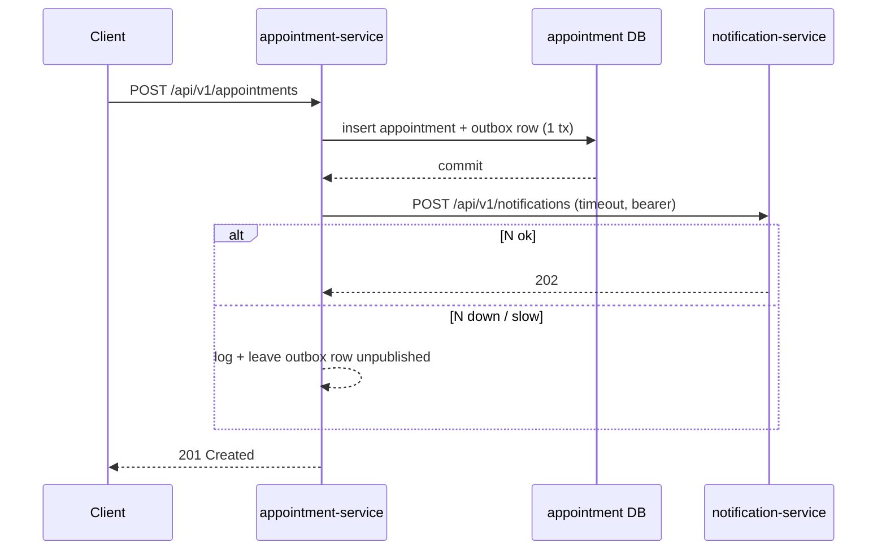
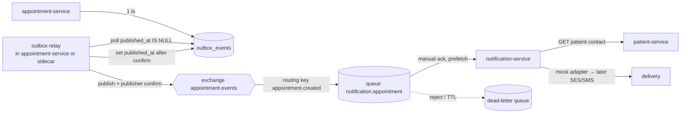
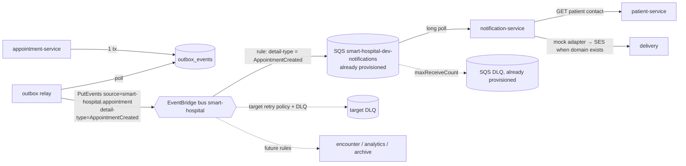

# Smart Hospital — Architecture Options Trade-Off: Booking Notifications

**Problem.** appointment-service must notify the patient after a successful booking. Notification must improve
reliability, scalability and maintainability, and **booking must keep working when notification processing is
unavailable**. This document compares **Option A: synchronous REST**, **Option B: asynchronous RabbitMQ** and
**Option C: AWS EventBridge**.

Related reports: `cross-repository-discovery.md` (`F-xx`, PR #1) and `dependency-mapping.md` (`D-xx`, branch
`devin/1793641500-dependency-mapping`). This is analysis only; no code or infrastructure was changed.

> **No benchmarks, prices or SLAs are asserted here.** Wherever a number or provider guarantee matters, it is listed
> under §9 *Requires measurement or provider validation*. Weights in §7 are **illustrative until agreed**.

---

## 1. Current state (facts from the repositories)

| # | Fact | Evidence | Confidence |
|---|---|---|---|
| C-1 | Book, reschedule and cancel write an `outbox_events` row **in the same DB transaction** as the appointment change: flush, add the event, commit; any failure rolls back both | `appointment-service:app/services/appointment_service.py:188-207` (`_save`); `README.md:203-206` | Confirmed |
| C-2 | Event types are `AppointmentCreated`, `AppointmentRescheduled` and `AppointmentCancelled`. Check-in, complete and no-show emit no events | `app/domain/appointments.py`; `README.md:203-205` | Confirmed |
| C-3 | The payload has IDs, times and status only (`event_type, appointment_id, patient_id, provider_id, facility_id, starts_at, ends_at, status, version, occurred_at`), with **no contact details or clinical data**. There is no `schema_version` field | `appointment_service.py:209-230`; `app/models/outbox_event.py` docstring | Confirmed |
| C-4 | `outbox_events(published_at NULL)` is indexed for a relay (`ix_outbox_events_published_at_occurred_at`), but **no relay, publisher, broker client or consumer exists** | `app/models/outbox_event.py:19-31`; no broker code in any repository (search for rabbitmq, amqp, eventbridge, kafka: no hits) | Confirmed |
| C-5 | **notification-service has no repository or code.** Only infrastructure exists: an SQS queue `smart-hospital-dev-notifications` with a DLQ, and IAM grants for SQS send/receive/delete and SES send | `smart-hospital-infra:infra/terraform/environments/dev/main.tf:28-45,127-140,161`; `modules/sqs/main.tf` | Confirmed |
| C-6 | SQS module: SSE enabled on both queues, long polling (`receive_wait_time_seconds = 20`), redrive to the DLQ after `max_receive_count`, DLQ retention 1,209,600 s (14 days), TLS-only queue policy. Main-queue visibility and retention are variables | `modules/sqs/main.tf:1-24,51`; `modules/sqs/variables.tf:6-18` | Confirmed |
| C-7 | The SES identity is created only with a custom domain (`count = var.enable_ses && local.use_custom_domain`), and dev has `hosted_zone_name = null`. **So SES isn't provisioned in dev today** | `dev/main.tf:17,134-136`; `dev/terraform.tfvars:111,135` | Strongly indicated (not checked in a live plan) |
| C-8 | appointment holds only `patient_id`. There is **no patient-service client anywhere**, so nothing in the system can resolve a patient's contact details today | `dependency-mapping.md` §8.2; D-06 | Confirmed |
| C-9 | Rules: notification must be **transport-independent**, start with a mock adapter and a durable request/status model, and add a broker **only when explicitly requested and justified**. Content must be generic and non-clinical. Notification processing must be idempotent | `AGENTS.md:35,45,60`; `Smart_Hospital_Repository_Rules.md:34,46,49,50` | Confirmed |
| C-10 | Service-to-service calls today are synchronous HTTP with the user's bearer token forwarded. There is no service identity (F-08) | D-01, D-02 | Confirmed |

**Net current behaviour:** a successful booking commits a durable `AppointmentCreated` record, and **no patient is
notified**. Booking already does not depend on notification, which is the property to preserve.

---

## 2. Requirements and constraints (proposed, to agree)

- **R1 Booking isolation:** a booking commits and returns 201 whether notification is up, slow or down.
- **R2 No lost notifications:** every committed `AppointmentCreated` eventually produces a notification attempt or
  lands in a reviewable dead-letter store.
- **R3 Duplicate safety:** at-least-once delivery is acceptable; the patient must not receive duplicate messages
  (dedupe on `event id` or `appointment_id + version + event_type`).
- **R4 Minimum data:** events carry IDs only. notification-service resolves contact details itself from
  patient-service (a new sync dependency) and sends generic text.
- **R5 Ordering:** per appointment, a cancel must not be delivered before the create. Global ordering isn't needed.
- **Constraints:** AWS dev account (EKS, RDS, SQS already provisioned), small team, a demo with synthetic data only, the
  broker rule in C-9, and no real email/SMS without approval (`AGENTS.md:60`).

---

## 3. Options

### Option A — Synchronous REST (appointment → notification-service)

To meet R1, the call has to happen **after the commit** and its failure must be swallowed. That makes the outbox the
real reliability mechanism, and a retry loop (a relay) is still needed for R2. Without one, Option A loses
notifications whenever notification-service is down.

### Option B — Asynchronous RabbitMQ (outbox relay → exchange → queue)

This needs a RabbitMQ cluster (self-managed on EKS, e.g. via the operator, or Amazon MQ for RabbitMQ) plus AMQP
clients in Python. None of this is provisioned today.

### Option C — AWS EventBridge (outbox relay → custom bus → rule → SQS → consumer)

The SQS target reuses C-5 and C-6. The relay needs `events:PutEvents` (via IRSA for appointment-service) and the bus,
rule, target and DLQ in Terraform. None of these exist today.

> **All three options need the same three new components:** an **outbox relay** (to meet R2), a **notification-service**
> with a durable request/status table and an idempotency key, and a **patient contact lookup**. The options differ only
> in transport between the relay and notification-service.

---

## 4. Comparison

| Criterion | A — Sync REST | B — RabbitMQ | C — EventBridge (+ SQS target) |
|---|---|---|---|
| Functional fit | Point-to-point only; each new consumer is another call from appointment | Fan-out with exchanges and bindings | Fan-out with rules; content-based filtering on event fields |
| Availability coupling | Notification latency sits on the booking path unless the call is after commit and async | Booking is decoupled; the relay depends on broker availability | Booking is decoupled; the relay depends on the EventBridge regional endpoint |
| Failure isolation (R1) | Weak by default; acceptable only with "after commit + swallow + relay" | Strong: the queue buffers while the consumer is down | Strong: the SQS target buffers while the consumer is down |
| Delivery semantics | At-most-once without a relay; at-least-once with the outbox relay | At-least-once with publisher confirms + manual acks | At-least-once (EventBridge → target, SQS → consumer) |
| Retries | Hand-written in the relay (backoff, cap) | Redelivery on nack; delayed retry needs DLX/TTL patterns or a plugin | EventBridge target retry policy + SQS redrive (`maxReceiveCount`, C-6) |
| Duplicate handling | Needed when the relay retries a call whose 202 was lost | Needed (redelivery) | Needed (both hops are at-least-once) |
| Idempotency | Idempotency key in the request to notification-service | Consumer dedupe table keyed by event id | Consumer dedupe table keyed by event id (EventBridge event id or outbox id) |
| Ordering (R5) | Natural per call, lost across retries | Per-queue FIFO with a single consumer; lost with competing consumers or requeue | Not guaranteed by EventBridge or SQS standard; the consumer must check `version` (C-3) |
| Retention / replay | None beyond the outbox | Until consumed; no replay after ack (streams aside) | SQS retention (variable, C-6); EventBridge archive/replay is optional |
| Performance | Adds a network hop per booking if called inline | Low-latency broker; needs measurement | Two managed hops; latency needs measurement |
| Scalability | Scales with notification-service replicas; backpressure hits appointment | Queue depth + consumer replicas; cluster sizing needed | Managed; scale consumers on SQS depth (service quotas apply) |
| Security | Reuses JWT (F-08: user token forwarded; a service identity is needed) | AMQP users and vhosts, TLS, secrets to rotate; a new network surface in the cluster | IAM/IRSA only; SSE on SQS (C-6); no new credentials to store |
| Observability | HTTP traces in Datadog (already present) | Broker metrics need an exporter and dashboards | CloudWatch metrics for the bus, rules and SQS; Datadog AWS integration (to validate) |
| Operational support | Lowest new infrastructure | **Highest**: run, upgrade and patch the broker, quorum queues, backups | Low: managed service; Terraform resources only |
| Total cost | No new infrastructure | Broker compute/storage or Amazon MQ instance (validate) | Per-event and per-request charges (validate) |
| Vendor lock-in | None | Low (AMQP is portable) | **High** (AWS-specific API and rule syntax) |
| Portability | High | High (any cloud or on-prem) | Low; mitigated by keeping a transport port in code (C-9) |
| Maintainability | Simple code, but coupling grows with consumers | Extra moving parts and client libraries | Few moving parts; the schema contract lives in the code repos |
| Migration effort | Smallest | Largest (new platform component) | Medium (Terraform + relay + IRSA) |
| Disaster recovery | Outbox in RDS is the only durable store | Broker state must be backed up or rebuilt; the outbox allows re-drive | Regional service; the outbox allows re-drive; cross-region needs design |
| Fit with repo rules (C-9) | Fits "no broker" | Adds a broker, so needs explicit justification | Adds a managed bus, so needs explicit approval (treated as a broker) |

### Advantages and disadvantages

- **A — Sync REST.** *Pros:* simplest, no new platform, and the same pattern as D-01 and D-02. *Cons:* doesn't meet R1
  and R2 on its own. Every new consumer increases appointment's coupling. Retries and idempotency are hand-written.
  Backpressure lands on booking.
- **B — RabbitMQ.** *Pros:* portable, mature routing, low lock-in. *Cons:* nothing is provisioned, so the team must
  operate a stateful broker on spot nodes (F-18). Ordering and duplicates still need consumer logic. A new credential
  and network surface.
- **C — EventBridge + SQS target.** *Pros:* reuses the provisioned SQS queue and DLQ, uses IAM instead of stored
  credentials, gives managed fan-out for future encounter and analytics consumers, and has low operational load.
  *Cons:* AWS lock-in, two at-least-once hops, no ordering, and per-event cost and quotas to validate.

---

## 5. Risks

| Risk | A | B | C | Mitigation |
|---|---|---|---|---|
| Booking slowed or failed by notification | **High** | Low | Low | Call after commit, or use async |
| Lost notification (relay crash, broker loss) | High without a relay | Medium | Low–Medium | Outbox + relay sets `published_at` only after confirm/ack |
| Duplicate patient messages | Medium | Medium | Medium | Dedupe table on event id; idempotent send |
| Out-of-order cancel/create | Low | Medium | Medium | Consumer compares `version` and ignores stale events |
| PHI leakage in events or logs | Low | Low | Low | Keep the IDs-only payload (C-3); generic templates |
| Outbox growth (F-09) | All | All | All | Retention job for published rows |
| Operational burden on a small team | Low | **High** | Low | Managed option or deferral |
| Lock-in | None | Low | **High** | Transport port + adapter in the relay |

## 6. Assumptions

- Volume is demo/dev scale. **No production volume figures exist in the repositories.**
- AWS stays the platform (the current Terraform and EKS make this Strongly indicated).
- notification-service will be built as the planned Phase 8 service (`AGENTS.md:28`) with its own DB.
- Notification is "best effort, eventually delivered": a delay of minutes is acceptable. This needs agreement.

---

## 7. Weighted decision matrix (weights **illustrative until agreed**; scores 1–5, higher is better)

| Criterion | Weight | A | B | C |
|---|---|---|---|---|
| Booking isolation (R1) | 20 | 2 | 5 | 5 |
| No lost notifications (R2) | 15 | 2 | 4 | 4 |
| Duplicates / idempotency / ordering effort | 10 | 3 | 3 | 3 |
| Operational support burden | 15 | 5 | 2 | 4 |
| Security model fit | 10 | 3 | 3 | 5 |
| Scalability / fan-out | 10 | 2 | 4 | 5 |
| Portability / lock-in | 5 | 5 | 5 | 2 |
| Migration effort | 5 | 5 | 2 | 3 |
| Cost (pending validation) | 5 | 5 | 3 | 4 |
| Observability | 5 | 4 | 3 | 4 |
| **Weighted total (/500)** | **100** | **320** | **355** | **415** |

The scores are qualitative judgements from §4, not measurements. Changing the weights (e.g. raising portability)
can change the ranking. Recompute after agreeing the weights.

---

## 8. Recommendation (proposed)

1. **Make the transport independent of the decision.** For every option, first build the **outbox relay** and
   **notification-service** (durable request/status table, idempotency key on the outbox event id, version check,
   mock adapter). This satisfies C-9 and R1–R5 regardless of the transport.
2. **Prefer Option C (EventBridge → existing SQS queue)** as the transport. It is the illustrative leader and reuses
   the provisioned SQS and DLQ, IAM security and the managed platform. Keep a `Publisher` port in the relay so a
   RabbitMQ or SQS-direct adapter can replace it.
3. **Not chosen:** Option A as the primary path (fails R1/R2 unless it already has a relay, at which point it is just
   a worse transport). Option B unless portability off AWS becomes a hard requirement or the team already runs RabbitMQ.
4. **Decision gate:** per `AGENTS.md:35,60`, adding a bus or broker needs explicit approval. This document is the
   justification input, not the approval.

*Note:* a narrower variant, relay → SQS directly (skipping EventBridge), also fits the provisioned infrastructure. It
trades fan-out and filtering for one fewer hop and less lock-in surface. It should be included in the POC as a
comparison point.

---

## 9. Requires measurement or provider validation

| Item | How to validate |
|---|---|
| End-to-end latency booking → notification request (each option) | POC load test with timestamps in the outbox, relay, consumer and DB |
| Throughput limits and quotas (EventBridge PutEvents, SQS, Amazon MQ instance sizes) | Current AWS documentation and Service Quotas console for `us-east-1` |
| Cost per month at the agreed volume | AWS Pricing Calculator and Amazon MQ pricing pages at decision time |
| EventBridge target retry and DLQ behaviour, and archive/replay limits | Current AWS EventBridge documentation + POC fault injection |
| RabbitMQ (quorum queues) behaviour on spot node loss | POC chaos test on the EKS spot node group |
| Datadog coverage of EventBridge/SQS metrics | Datadog AWS integration docs + POC dashboard |
| SES sending limits and sandbox status | SES account settings after the custom domain exists (C-7) |

## 10. Unanswered questions

1. Which channels (email, SMS, both) apply, and must notifications be sent in a particular timezone or window?
2. What delay is acceptable from booking to notification, and what volume is expected?
3. Do reschedule and cancel also notify (the events exist, C-2)?
4. Patient consent and contact preferences: where are they owned? (patient-service has `phone` and `email` only)
5. Which service identity will notification-service use to call patient-service (F-08)?
6. Outbox retention period and who owns the relay (appointment-service process vs a separate worker)?
7. Is AWS lock-in acceptable long-term (relevant to the B vs C weighting)?

## 11. POC / validation plan

| Step | Scope | Exit criteria |
|---|---|---|
| P0 | Agree R1–R5, weights and volume assumptions | Signed-off weights in §7 |
| P1 | Outbox relay with a `Publisher` port + an in-memory adapter; notification-service skeleton with a dedupe table and mock adapter (local, synthetic data) | Tests: booking returns 201 with notification down; one notification per event under duplicate delivery; stale version ignored |
| P2 | Adapter C (EventBridge → SQS) and the SQS-direct variant in the dev account (Terraform behind a flag) | The same tests pass against AWS; DLQ receives poison messages; Datadog shows the queue depth |
| P3 | Optional adapter B (RabbitMQ on EKS) only if Q7 says portability matters | The same tests; record the operational steps needed |
| P4 | Fault injection: kill the consumer, kill the relay, throttle the bus/broker, spot node interrupt | No lost events (outbox vs consumer counts match); booking p95 unchanged (measured) |
| P5 | Decision record (ADR) with measured latency, cost estimate and operational notes | ADR approved; then implement Phase 8 |
