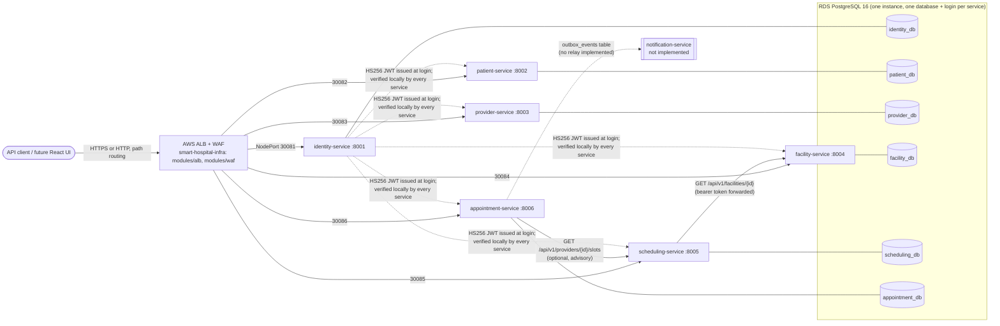

# Smart Hospital — Cross-Repository Architecture Discovery

| | |
|---|---|
| **Scope** | All Smart Hospital repositories in the `UST-HealthCare-Project` GitHub organization (9 repositories, split from the monorepo `Msocial123/UST-HealthCare-Project` at commit `63bf585`, with per-path git history) |
| **Method** | Read-only static analysis of source, configuration, Helm, Argo CD, Terraform and GitHub Actions. No code, configuration, infrastructure or pipeline was changed. No service was run and nothing was queried in a live environment |
| **Evidence labels** | **Confirmed**: read directly in the cited file. **Strongly indicated**: follows from several confirmed facts, but no single file states it. **Hypothesis**: plausible reading that needs verification. **Unknown**: no evidence in any repository |
| **Path convention** | `repo:path:lines`. Service repos have the former `services/<name>/` content at the root. `smart-hospital-gitops` keeps `deploy/`, `smart-hospital-infra` keeps `infra/`, and `smart-hospital-architecture` keeps `docs/` and the root governance files, so monorepo-relative paths still work inside those three |

> Development demo with synthetic data only. Nothing in this report is a claim of clinical, HIPAA or GDPR compliance.

---

## 1. Repository inventory

| # | Repository | Business responsibility | Former monorepo path | Commits kept | Status |
|---|---|---|---|---|---|
| 1 | `identity-service` | Staff user accounts, Argon2id password hashes, demo roles, JWT access-token issuance (the token contract every other service verifies) | `services/identity-service/` | 5 | Implemented (Phase 1) |
| 2 | `patient-service` | Patient registration, demographics, contact data, patient search, deactivation | `services/patient-service/` | 5 | Implemented (Phase 2) |
| 3 | `provider-service` | Provider (doctor) profiles, specialties, active status | `services/provider-service/` | 3 | Implemented (Phase 3) |
| 4 | `facility-service` | Facilities, departments, rooms, facility IANA timezone | `services/facility-service/` | 5 | Implemented (Phase 4) |
| 5 | `scheduling-service` | Provider working hours, availability exceptions, advisory free-slot queries | `services/scheduling-service/` | 6 | Implemented (Phase 5) |
| 6 | `appointment-service` | Booking lifecycle (book, reschedule, cancel, check-in, complete, no-show), double-booking prevention, transactional outbox | `services/appointment-service/` | 3 | Implemented (Phase 6) |
| 7 | `smart-hospital-gitops` | Argo CD app-of-apps, ApplicationSet, shared Helm library chart `microservice`, one Helm chart per service, `db-bootstrap` job, Datadog Agent values | `deploy/` | 12 | Live dev deployment still tracks the monorepo (see F-01) |
| 8 | `smart-hospital-infra` | Terraform for AWS (VPC, EKS, RDS, ECR, Secrets Manager, IRSA, ALB, WAF, SQS, SES, S3, GitHub OIDC, Datadog), plus a separate `clinical-platform` root and a `dev-observability` root | `infra/` | 18 | Terraform state not in Git |
| 9 | `smart-hospital-architecture` | Governance and documentation: `AGENTS.md`, `Smart_Hospital_Repository_Rules.md`, root README, governed SDLC, Devin playbook, Care Points test design, PR template, this report | `AGENTS.md`, `Smart_Hospital_Repository_Rules.md`, `README.md`, `docs/`, `.github/pull_request_template.md` | 17 | — |
| — | `encounter-service` | Visit records, non-diagnostic administrative notes (Phase 7) | — | — | **No repository and no code.** AWS resources only (see F-11) |
| — | `notification-service` | Notification requests, templates, mock adapters, delivery status (Phase 8) | — | — | **No repository and no code.** AWS resources only (see F-11) |

Evidence: `smart-hospital-architecture:README.md:10-21` (phase table, Confirmed); `smart-hospital-architecture:AGENTS.md` "Eight microservices and boundaries" (Confirmed); `smart-hospital-gitops:deploy/README.md:41-42` ("encounter-service and notification-service have AWS resources but no code yet", Confirmed).

---

## 2. Architecture overview



- **Style (Confirmed):** six independently deployable FastAPI services, one database per service on a shared RDS instance, synchronous HTTP/JSON between services, stateless JWT verification. `AGENTS.md` and `Smart_Hospital_Repository_Rules.md` ("Cross-service integration") forbid cross-service database access.
- **Inside each service (Confirmed):** the same layered layout in every repository: `app/api` (routers, deps, errors, middleware), `app/core` (config, tokens, logging, errors, time), `app/domain` (enums, role→permission map, pure rules), `app/models`, `app/repositories`, `app/schemas`, `app/services` (use cases), plus `app/clients` in the two services that call others. Application factory: `app/main.py:create_app` (run as `uvicorn app.main:create_app --factory`, per each `Dockerfile` `CMD`).
- **Delivery (Confirmed):** GitHub Actions builds images to ECR, CI writes the image tag into `deploy/helm/<svc>/dev-values.yaml`, and Argo CD syncs to EKS (`smart-hospital-gitops:deploy/README.md:3-11`). After the split, this chain no longer works end to end (F-01, F-02).
- **No API gateway, no frontend, no broker** (Confirmed). `AGENTS.md` lists the gateway and frontend as future scope. The only "gateway" is ALB path routing.

---

## 3. Technology matrix

| Repository | Language / runtime | Frameworks and key libraries (pinned in `requirements.txt`) | Data store | Outbound calls | Container |
|---|---|---|---|---|---|
| identity-service | Python ≥3.12 (`pyproject.toml`) | FastAPI 0.143.1, Pydantic 2.14.1, pydantic-settings 2.16.0, SQLAlchemy 2.1.4, Alembic 1.20.0, psycopg 3.3.6, PyJWT 2.15.1, **argon2-cffi 25.1.0**, email-validator | PostgreSQL (`users`) | none | `python:3.12-slim`, port 8001 |
| patient-service | Python 3.12 | same base stack + email-validator | PostgreSQL (`patients`) | none | 8002 |
| provider-service | Python 3.12 | same base stack + email-validator | PostgreSQL (`providers`, `specialties`, `provider_specialties`) | none | 8003 |
| facility-service | Python 3.12 | same base stack + email-validator, tzdata | PostgreSQL (`facilities`, `departments`, `rooms`) | none | 8004 |
| scheduling-service | Python 3.12 | same base stack + tzdata, **httpx 0.28.1** | PostgreSQL (`working_hours`, `availability_exceptions`) | facility-service | 8005 |
| appointment-service | Python 3.12 | same base stack + tzdata, **httpx 0.28.1** | PostgreSQL + `btree_gist` (`appointments`, `outbox_events`) | scheduling-service (optional) | 8006 |
| smart-hospital-gitops | Helm v2 charts, Argo CD (Application, ApplicationSet), External Secrets Operator 2.14.0, Datadog chart 3.262.0 | — | — | AWS Secrets Manager (via ESO + IRSA) | — |
| smart-hospital-infra | Terraform ≥1.10 (validated with 1.17.0 per README), AWS provider, Datadog provider | — | S3 remote state with native locking | AWS, Datadog | — |
| smart-hospital-architecture | Markdown, CSV | — | — | — | — |

Shared tooling (Confirmed, identical in every service `pyproject.toml`): ruff (line length 110, rules E/F/W/I/B/UP/S/N/SIM), pytest with `filterwarnings = error::DeprecationWarning:app.*`. Test files and `def test_` counts: identity 12/78, patient 8/53, provider 9/65, facility 11/65, scheduling 12/88, appointment 11/66. These are counts of test functions only; no test was run for this report.

---

## 4. Entry points, APIs and protocols

Every service exposes `GET /health` (liveness) and `GET /health/ready` (database check) from `app/api/health.py:11,16`, plus `/api/v1/...` routers mounted in `app/main.py`. FastAPI OpenAPI docs are on by default (no `docs_url` override found, Strongly indicated). Protocol everywhere: HTTP/JSON with bearer JWT. No gRPC, GraphQL, WebSocket or broker client exists in any service (Confirmed: no `kafka|rabbit|sqs|boto3|celery|redis` match in `app/` or the requirements files).

| Service | Endpoints (prefix `/api/v1`) | Evidence |
|---|---|---|
| identity | `POST /auth/login`, `GET /auth/me`; `GET/POST /users`, `GET/PATCH /users/{id}`, `POST /users/{id}/password`; `GET /roles`. CLI: `python -m app.cli seed-demo-users` | `app/api/v1/auth.py:15-34`, `users.py:23-64`, `roles.py:14`, `app/cli.py` |
| patient | `POST/GET /patients`, `GET/PATCH /patients/{id}`, `POST /patients/{id}/deactivate` | `app/api/v1/patients.py:24-80` |
| provider | `POST/GET /providers`, `GET/PATCH /providers/{id}`, `POST /providers/{id}/deactivate`, `POST /providers/{id}/activate`; `POST/GET /specialties`, `PATCH /specialties/{id}` | `app/api/v1/providers.py:24-101`, `specialties.py:22-53` |
| facility | `POST/GET /facilities`, `GET/PATCH /facilities/{id}`, `POST /facilities/{id}/deactivate`, `POST /facilities/{id}/activate`, `POST/GET /facilities/{id}/departments`; `GET/PATCH /departments/{id}`, `POST/GET /departments/{id}/rooms` | `app/api/v1/facilities.py:30-146`, `departments.py:30-69` |
| scheduling | `POST/GET /providers/{id}/working-hours`, `PATCH/DELETE /working-hours/{id}`; `POST/GET /providers/{id}/exceptions`, `PATCH/DELETE /exceptions/{id}`; `GET /providers/{id}/slots?facility_id&date_from&date_to` | `app/api/v1/working_hours.py:24-85`, `exceptions.py:23-94`, `slots.py:34-75` |
| appointment | `POST/GET /appointments`, `GET /appointments/{id}`, `POST /appointments/{id}/reschedule`, `/cancel`, `/check-in`, `/complete`, `/no-show` | `app/api/v1/appointments.py:50-201` |

**Service-to-service contracts (Confirmed)**

| Caller → callee | Contract | Failure handling | Evidence |
|---|---|---|---|
| scheduling → facility | `GET /api/v1/facilities/{id}`; reads only `id`, `timezone`, `is_active`; caller's bearer token forwarded; no redirects | 404 → `NotFoundError`; transport error, non-200 or invalid body → 503 `ServiceUnavailableError`; timeout `FACILITY_TIMEOUT_SECONDS` (default 3) | `scheduling-service:app/clients/facility_client.py:55-87` |
| appointment → scheduling | `GET /api/v1/providers/{id}/slots` with `facility_id` and a ±1-day local date window; checks that the slots cover `[starts_at, ends_at)` | 404 → "Facility not found", 409 → "Facility is inactive", otherwise 503; timeout `SCHEDULING_TIMEOUT_SECONDS` | `appointment-service:app/clients/scheduling_client.py:56-101` |

Wiring in Kubernetes uses Service DNS names (`http://facility-service:8004`, `http://scheduling-service:8005`) set in `smart-hospital-gitops:deploy/helm/scheduling-service/values.yaml` (env `FACILITY_SERVICE_URL`) and `deploy/helm/appointment-service/values.yaml:53-61` (Confirmed).

---

## 5. Databases, migrations and data ownership

| Service | Tables (owner) | Migration | Notable integrity rules | Cross-service references |
|---|---|---|---|---|
| identity | `users` | `migrations/versions/0001_create_users_table.py` | unique email, `email = lower(email)`, role check constraint (`app/models/user.py:16-34`) | none |
| patient | `patients` | `0001_create_patients_table.py` | unique `medical_record_number`, sex check constraint, lower-case name indexes (`app/models/patient.py:16-45`) | none |
| provider | `providers`, `specialties`, `provider_specialties` | `0001_create_provider_tables.py` | unique `provider_number` and `license_number`; FK provider→specialty within the service (`app/models/provider.py:26-78`) | `facility_id`, `department_id`: plain UUIDs, **not validated** (F-06) |
| facility | `facilities`, `departments`, `rooms` | `0001_create_facility_tables.py` | unique code; `(facility_id, code)` and `(department_id, room_number)` unique; FKs inside the service (`app/models/department.py:13-27`, `room.py:13-28`) | none |
| scheduling | `working_hours`, `availability_exceptions` | `0001_create_scheduling_tables.py` | weekday, slot-length and validity checks; type in LEAVE/HOLIDAY/BLOCKED/EXTRA_HOURS (`app/models/working_hours.py:18-38`, `availability_exception.py:19-37`); per-provider row lock on writes (`app/services/working_hours_service.py:30,131`) | `provider_id` not validated (F-06); `facility_id` validated through facility-service |
| appointment | `appointments`, `outbox_events` | `0001_create_appointment_tables.py` (creates `btree_gist`) | **GiST exclusion constraint `ex_appointments_provider_overlap`** on `(provider_id =, tstzrange(starts_at, ends_at,'[)') &&)` for BOOKED/CHECKED_IN/COMPLETED; optimistic lock `version_id_col` (`app/models/appointment.py:15-63`; migration lines 24-25, 65) | `patient_id`, `provider_id`, `facility_id`: opaque UUIDs with no FK and **no existence check** (F-05) |

- **Physical isolation (Confirmed):** one RDS PostgreSQL 16 instance (`db.t3.micro`, single-AZ) with one database per service (`identity_db` … `notification_db`) in `smart-hospital-infra:infra/terraform/environments/dev/terraform.tfvars` (the `services` map). Each service gets its own login from Secrets Manager `smart-hospital/dev/<svc>/database` (`deploy/helm/db-bootstrap/dev-values.yaml`). Roles and databases are created by the `db-bootstrap` Job (`deploy/helm/db-bootstrap/templates/job.yaml`).
- **Migrations at deploy time (Confirmed):** the Helm library chart runs `alembic upgrade head` in a Job before pods roll out (`smart-hospital-gitops:deploy/helm/microservice/templates/_migrationjob.tpl:1,30`). Downgrades are manual (`deploy/README.md`, "Rollout and rollback").
- **Shared instance (Strongly indicated):** the isolation is logical (database plus login), not physical, so all services share one failure domain and one capacity limit.

---

## 6. Messaging and external integrations

| Item | Evidence | Label |
|---|---|---|
| **Transactional outbox**: `AppointmentCreated`, `AppointmentRescheduled`, `AppointmentCancelled` rows are written in the same transaction as the appointment change. The payload holds IDs, times, status and version only | `appointment-service:app/services/appointment_service.py:188-230`, `app/models/outbox_event.py:84-103`, `app/domain/appointments.py:35-38` | Confirmed |
| **No outbox relay or publisher**: `published_at` is only ever set to `None`; no worker, cron or broker client exists | `grep published_at` returns only `appointment_service.py:229` | Confirmed |
| Check-in, complete and no-show transitions emit **no** event (`_save(appointment, None, …)`) | `appointment_service.py:144` | Confirmed |
| SQS notification queue + DLQ, SES domain identity, S3 shared bucket are provisioned; IAM grants SQS send/receive and SES send to `notification-service` only | `smart-hospital-infra:infra/terraform/environments/dev/main.tf:21-45,127-148`; `modules/sqs/main.tf:2,8` | Confirmed |
| The relay will publish outbox rows to SQS for notification-service | Outbox docstring says "A future relay publishes unpublished rows … to the Notification service"; the transport is not stated | Hypothesis |
| Datadog: Agent via Argo CD (metrics, logs, APM through Single Step Instrumentation, which injects `ddtrace` with no code change); API key from Secrets Manager via External Secrets | `smart-hospital-gitops:deploy/datadog/values.yaml:17-38`, `deploy/argocd/apps/templates/datadog.yaml`, `deploy/helm/datadog-secrets/` | Confirmed |
| AWS Secrets Manager via External Secrets Operator + IRSA; ECR; GitHub OIDC for CI | `deploy/helm/microservice/templates/_externalsecret.tpl:1-51`; `infra/terraform/modules/github-oidc/main.tf:36-37` | Confirmed |
| Jira, qTest and Figma are used in the delivery workflow (playbook), not at runtime | `smart-hospital-architecture:docs/workflow/devin-playbook-v2.md`, `docs/workflow/governed-sdlc.md` | Confirmed (process only) |

---

## 7. Authentication and authorization

- **Issuance (Confirmed):** `identity-service:app/core/tokens.py:40-63` (`TokenService.issue_access_token`). HS256/384/512 with a `kid` header. Claims: `iss`, `aud`, `sub` (user UUID), `iat`, `nbf`, `exp`, `jti`, `token_use="access"`, `roles=[<single role>]`. Lifetime `JWT_ACCESS_TOKEN_EXPIRE_MINUTES` (1–60, default 15). Passwords are hashed with Argon2id (`app/core/passwords.py:1-4`).
- **Verification (Confirmed):** every other service has its own `app/core/tokens.py` (`TokenVerifier`, `Principal`) that verifies signature, `kid`, `iss`, `aud`, expiry with leeway and `token_use`, locally and **without calling identity at runtime** (provider `tokens.py` docstring). Keys: `JWT_SECRET_KEY` + `JWT_KEY_ID`, rotation through `JWT_PREVIOUS_KEYS` (`appointment-service:app/core/config.py:43-108`). Config refuses short or placeholder keys at startup.
- **Shared secret (Confirmed):** a single symmetric key, `smart-hospital/dev/shared/jwt-signing-key` (`smart-hospital-infra:infra/terraform/modules/secrets/main.tf:34-49`), is mounted into every service (`_externalsecret.tpl:45-51`). Any service that can verify tokens can also mint them (F-07).
- **Authorization (Confirmed):** RBAC. Four roles (`ADMIN`, `RECEPTIONIST`, `DOCTOR`, `READ_ONLY`) are copied into every service's `app/domain/roles.py`, and each service maps them to its own permissions (e.g. `appointments:book` for ADMIN/RECEPTIONIST only, `appointment-service:app/domain/roles.py:13-24`). Checked server-side by the `require_permission` dependency (`appointment-service:app/api/deps.py:73-87`).
- **Booking feature flag (Confirmed):** `APPOINTMENTS_ENABLED` (default false) returns 503 `feature_disabled` *after* the auth check (`appointment-service:app/api/deps.py:104-107`, `appointments.py:37-38`); dev sets it to `"true"` (`deploy/helm/appointment-service/dev-values.yaml`).
- **No token revocation (Confirmed):** `jti` is parsed but never checked against a denylist. Identity alone re-checks `user.is_active` on each request (`identity-service:app/api/deps.py:45-60`); in the other services a disabled user's token stays valid until it expires (≤60 min).
- **No end-user or patient identity (Confirmed):** all roles are staff roles. There is no patient login, no OAuth/OIDC provider and no service-to-service identity: services forward the caller's token (F-08).

---

## 8. Deployment and infrastructure

| Concern | Configuration | Evidence | Label |
|---|---|---|---|
| Cluster | EKS 1.34, managed node group of t3.medium/t3a.medium **spot** nodes (2–3), namespace `smart-hospital`, us-east-1, account `165742853391` | `smart-hospital-infra:infra/terraform/environments/dev/terraform.tfvars` | Confirmed |
| Ingress | Internet-facing ALB, one rule per path pattern (priority = service priority + index), NodePort targets 30081–30088, WAF rate limit 2000 req / 5 min per IP; HTTP only while `hosted_zone_name = null` | `modules/alb/main.tf:4-10,147-156`; tfvars | Confirmed |
| GitOps | `root-app.yaml` → `deploy/argocd/apps` chart → ApplicationSet `smart-hospital-services` with a git directory generator over `deploy/helm/*-service`; automated prune + selfHeal | `smart-hospital-gitops:deploy/argocd/root-app.yaml:12-14`, `apps/values.yaml:1-26`, `apps/templates/microservices.yaml:1-37` | Confirmed |
| Charts | Library chart `microservice` (Deployment, NodePort Service, IRSA ServiceAccount, ConfigMap with `PORT`, ExternalSecret, migration Job); each service chart depends on it via `file://../microservice` | `deploy/helm/appointment-service/Chart.yaml:6-9`, `deploy/helm/microservice/templates/*.tpl` | Confirmed |
| CI (lint/test) | `.github/workflows/ci.yml`: hard-coded matrix of 6 services, `working-directory: services/<svc>`, ruff, pytest on SQLite and PostgreSQL 16, Alembic round trip, gitleaks | monorepo `.github/workflows/ci.yml:20-36,59-106` | Confirmed (monorepo only) |
| CD (build) | `.github/workflows/build-push.yml`: detects changed `services/*`, builds with context `services/<svc>`, pushes `smart-hospital/<svc>:<sha12>` to ECR via OIDC role `smart-hospital-dev-github-actions`, then commits `image.tag` into `deploy/helm/<svc>/dev-values.yaml` in the same repo | monorepo `.github/workflows/build-push.yml` | Confirmed (monorepo only) |
| Second Terraform root | `environments/clinical-platform`: separate VPC `10.30.0.0/16`, EKS `clinical-platform-eks`, 6 ECR repos under `clinical-platform/<svc>`; no RDS, ALB or secrets | `smart-hospital-infra:infra/terraform/environments/clinical-platform/README.md:1-12` | Confirmed |
| Observability root | `environments/dev-observability`: optional Terraform for Datadog dashboards/SLOs/monitors; README says the live objects were created through the API and the stack must not be applied on top of them | `smart-hospital-gitops:deploy/README.md` "Monitoring (Datadog)" | Confirmed |

---

## 9. Shared libraries and reusable components

- **No shared code package exists (Confirmed).** No repository is a Python library, and no service depends on another's package. Cross-cutting code is **copied** into each service:

  | Module | Copies | Drift (md5 across 6 services) |
  |---|---|---|
  | `app/core/tokens.py` (verifier) | 5 | provider, facility, scheduling and appointment are byte-identical; patient differs only in docstrings; identity is the issuer variant |
  | `app/domain/roles.py` (`Role` enum) | 6 | same four roles, different permission maps (intended); identity's `has_permission` takes one role while the others take a set |
  | `app/api/middleware.py` | 6 | 2 variants |
  | `app/core/logging.py`, `app/api/errors.py` | 6 | 6 distinct variants each |
  | `app/core/errors.py` | 6 | 4 variants |
  | `app/db/types.py` (`UTCDateTime`) | 6 | identical |

- **Reusable deploy component (Confirmed):** the Helm library chart `smart-hospital-gitops:deploy/helm/microservice`.
- **Reusable infra components (Confirmed):** 17 Terraform modules under `smart-hospital-infra:infra/terraform/modules/`, used by both the `dev` and `clinical-platform` roots.
- **Shared contracts (Confirmed absent):** `AGENTS.md` allows a shared-contracts package for "API/event schemas only", but none exists. The JWT contract lives as prose in `identity-service/README.md`. The outbox event schema exists only as a dict literal in `appointment_service.py:216-227`.

---

## 10. Appointment booking journey (evidence-based trace)

```mermaid
sequenceDiagram
  autonumber
  actor R as Receptionist (staff)
  participant ID as identity-service
  participant PA as patient-service
  participant PR as provider-service
  participant FA as facility-service
  participant SC as scheduling-service
  participant AP as appointment-service
  participant DB as appointment_db
  R->>ID: POST /api/v1/auth/login (email, password)
  ID-->>R: JWT {sub, roles:[RECEPTIONIST], kid, iss, aud, exp≤60m}
  R->>PA: GET /api/v1/patients?... (find patient_id)
  R->>PR: GET /api/v1/providers?... (find provider_id)
  R->>FA: GET /api/v1/facilities?... (find facility_id)
  R->>SC: GET /api/v1/providers/{provider_id}/slots?facility_id&date_from&date_to
  SC->>FA: GET /api/v1/facilities/{facility_id} (token forwarded) → timezone, is_active
  SC-->>R: advisory slots (UTC + local)
  R->>AP: POST /api/v1/appointments {patient_id, provider_id, facility_id, starts_at, ends_at, reason_code}
  AP->>AP: verify JWT locally; require appointments:book; APPOINTMENTS_ENABLED?
  opt SCHEDULING_ADVICE_ENABLED
    AP->>SC: GET /providers/{id}/slots (token forwarded)
    SC->>FA: GET /facilities/{id}
    SC-->>AP: slots → interval_covered? else 409
  end
  AP->>DB: find_overlapping (pre-check) → INSERT appointment
  AP->>DB: INSERT outbox_events (AppointmentCreated), COMMIT
  Note over AP,DB: GiST exclusion constraint is the final guard (SQLSTATE 23P01 → 409)
  AP-->>R: 201 AppointmentRead
  Note over AP: No relay reads outbox_events; notification-service does not exist
```

| Capability | Participation in booking | Evidence | Label |
|---|---|---|---|
| **Identity** | Issues the JWT at login. Not called during booking; appointment-service verifies the token locally and records `created_by = principal.subject` | `identity-service:app/api/v1/auth.py:15-24`; `appointment-service:app/core/tokens.py:74`, `app/services/appointment_service.py:98` | Confirmed |
| **Patient** | **Not called by any service.** `patient_id` is stored as an opaque UUID; its existence or active status is not checked | `appointment-service:app/models/appointment.py:21,49`; no patient client in any repo | Confirmed |
| | The client is expected to look up the patient first (UI or caller responsibility) | inferred from the API shape only | Hypothesis |
| **Provider** | **Not called by any service.** `provider_id` is unchecked in both scheduling and appointment, so a deactivated provider can still have working hours and bookings | no provider client in `scheduling-service/app/clients/` or `appointment-service/app/clients/` | Confirmed |
| **Facility** | Called **indirectly**, by scheduling-service, for timezone and `is_active` during slot queries (and when working hours are created). Appointment-service never calls facility directly; with advice disabled, `facility_id` is unchecked | `scheduling-service:app/clients/facility_client.py:66-87`, `app/services/working_hours_service.py:26-27` | Confirmed |
| **Scheduling** | Advisory only. Called by appointment-service on book and reschedule **only when** `SCHEDULING_ADVICE_ENABLED=true` (true in dev); not called on cancel or transitions | `appointment-service:app/core/config.py:55-61`, `app/main.py:32-62`, `app/services/appointment_service.py:83,115,165-176`; dev flag in `deploy/helm/appointment-service/dev-values.yaml` | Confirmed |
| **Appointment** | Final authority: future-start check, optional advice, overlap pre-check, insert, exclusion constraint, optimistic version on reschedule/cancel/transitions, outbox row in the same transaction | `appointment-service:app/services/appointment_service.py:80-206`; `app/models/appointment.py:39-63` | Confirmed |
| **Encounter** | No participation. No code; CHECKED_IN/COMPLETED transitions emit no event that could open a visit | `appointment_service.py:144`; no repo | Confirmed (absent) |
| | Encounter will later be created from appointment check-in | ALB path `/api/v1/encounters*`/`visits*` reserved (tfvars) | Hypothesis |
| **Notification** | No participation. `AppointmentCreated/Rescheduled/Cancelled` are written to the outbox and never read. SQS/SES exist but nothing uses them | `outbox_event.py:85-89`; `environments/dev/main.tf:127-148` | Confirmed (absent) |

Failure behaviour: if scheduling or facility is unreachable while advice is on, booking returns **503** and nothing is written (`scheduling_client.py:87-99` raises before `_ensure_slot_free`). Advice therefore makes scheduling and facility hard runtime dependencies of booking (Strongly indicated).

---

## 11. Cross-repository findings (inconsistencies and technical debt)

| ID | Finding | Repository / evidence | Label | Impact |
|---|---|---|---|---|
| **F-01** | Argo CD still tracks the **monorepo**. `repoURL` points at `Msocial123/UST-HealthCare-Project`, and the ApplicationSet generator scans `deploy/helm/*-service` there. Changes in `smart-hospital-gitops` do not deploy until `repoURL` is changed and `bootstrap.sh` is re-run | `smart-hospital-gitops:deploy/argocd/apps/values.yaml:1`, `deploy/argocd/root-app.yaml:12-14`, `apps/templates/microservices.yaml:12-15` | Confirmed | Two sources of truth for the deployment until the cutover |
| **F-02** | **No service repository has CI or CD.** `ci.yml` and `build-push.yml` exist only in the monorepo; they use `services/<svc>` paths and write `image.tag` back into the *same* repo. In the split layout, a service build would have to commit to `smart-hospital-gitops` with cross-repo credentials | monorepo `.github/workflows/*.yml`; the split service repos have no `.github/` | Confirmed | No CP3 gate and no image builds in the new repos |
| **F-03** | GitHub OIDC trust is pinned to `repo:Msocial123/UST-HealthCare-Project:ref:refs/heads/main`. New repos cannot assume the ECR push role | `smart-hospital-infra:infra/terraform/environments/dev/terraform.tfvars` (`github_repository`, `github_allowed_subjects`), `modules/github-oidc/main.tf:36-37` | Confirmed | Image builds from new repos are blocked |
| **F-04** | Governance files (`AGENTS.md`, rules, PR template, `.gitignore`) live only in `smart-hospital-architecture`. Service repos have no `AGENTS.md`, no PR template and no `.gitignore` (so `.env` is not ignored there) | split repos (file listing) | Confirmed | Agent and reviewer rules are not applied, and there is a risk of committing `.env` |
| **F-05** | Appointment stores `patient_id`, `provider_id`, `facility_id` without existence or active-status checks; patient and provider are never consulted | `appointment-service:app/models/appointment.py:21,49-51` | Confirmed | Bookings for unknown or deactivated patients and providers |
| **F-06** | Scheduling never validates `provider_id`; provider-service never validates `facility_id`/`department_id` | `scheduling-service:app/clients/` (facility only); `provider-service:app/schemas/provider.py:53-54,72-73` (no client) | Confirmed | Orphan references across services |
| **F-07** | A single symmetric HS256 key is shared by all services, so every verifier can mint tokens. No per-service keys, no asymmetric signing, no JWKS | `smart-hospital-infra:modules/secrets/main.tf:34-49`; `_externalsecret.tpl:45-51` | Confirmed | Large blast radius if any one service is compromised |
| **F-08** | No token revocation and no service identity: downstream calls reuse the end user's token, and a disabled user's token stays valid in non-identity services until expiry | `appointment-service:app/api/deps.py:52-62`; `identity-service:app/api/deps.py:60` | Confirmed | Deactivation takes up to `exp` to apply |
| **F-09** | Outbox written but never published; no relay, no consumer, no retention or cleanup of `outbox_events` | `appointment_service.py:188-230` | Confirmed | Table grows without bound; notifications cannot happen |
| **F-10** | Cross-cutting code duplicated with drift (tokens, roles, logging, errors, middleware); no shared contracts package for the JWT claims or the event schema | md5 comparison, §9 | Confirmed | Contract changes need six coordinated PRs, now in six repos |
| **F-11** | Infra is provisioned for 8 services (ECR repos, DBs, IRSA, ALB rules 30087/30088, SQS/SES for notification), but code exists for 6 | `terraform.tfvars` `services` map; `deploy/README.md:41-42` | Confirmed | Idle cost and the attack surface of unused routes |
| **F-12** | ALB routes `/api/v1/identity*` to identity-service, but no such route exists | tfvars identity `path_patterns`; `identity-service` routers (§4) | Confirmed | Dead route |
| **F-13** | `infra/terraform/README.md:84` says "container port 8000", but the services listen on 8001–8006 (`Dockerfile` `EXPOSE`, Helm `containerPort`) | `smart-hospital-infra:infra/terraform/README.md:84`; `deploy/helm/*/values.yaml` | Confirmed | Documentation drift |
| **F-14** | Two Terraform roots for overlapping purposes: `dev` (`smart-hospital-*`, `10.20.0.0/16`, ECR `smart-hospital/<svc>`) and `clinical-platform` (`10.30.0.0/16`, ECR `clinical-platform/<svc>`); no pipeline or chart references the `clinical-platform` ECR namespace | `infra/terraform/environments/clinical-platform/README.md:1-12`; `build-push.yml` `ECR_NAMESPACE: smart-hospital` | Confirmed | Unclear target platform |
| **F-15** | Account ID `165742853391`, IAM role ARNs and the RDS master-secret ARN are hard-coded in `dev-values.yaml` and the workflow defaults | `deploy/helm/*/dev-values.yaml`; `build-push.yml` `AWS_ROLE_ARN` | Confirmed | Moving accounts requires edits across repos |
| **F-16** | Local and doc naming differ from dev: `.env.example` uses `identity_user@…/identity`, the infra README shows role `identity_service` / db `identity_db` | `identity-service:.env.example`; `infra/terraform/README.md` "Databases" | Confirmed | Minor; onboarding confusion |
| **F-17** | `smart-hospital-architecture:README.md` still links to `services/<name>/README.md`, which do not exist in that repo | `README.md:13-18` | Confirmed | Broken links after the split |
| **F-18** | Spot-only nodes for every service, with a single-AZ RDS on `db.t3.micro` | tfvars | Confirmed | Acceptable for dev; not a production baseline |
| **F-19** | CI matrix lists services by hand while `build-push.yml` discovers them dynamically | monorepo `ci.yml:26-33` vs `build-push.yml` `detect` step | Confirmed | A new service can be built without being tested |

---

## 12. Open questions

1. **Cutover:** when should Argo CD (`repoURL`), the GitHub OIDC trust (`github_repository`) and the CI/CD workflows move to the new repositories, and is the monorepo then archived? (F-01, F-02, F-03)
2. **Cross-repo CD:** should each service repo commit `image.tag` to `smart-hospital-gitops` (needs a GitHub App or deploy key), or should Argo CD Image Updater be used instead?
3. **Referential checks:** should appointment validate patient and provider active status at booking time (sync call), or rely on events or snapshots? (F-05, F-06)
4. **Outbox transport:** SQS (already provisioned) or another broker? Who owns the relay, and what is the outbox retention? (F-09)
5. **Signing keys:** stay on shared HS256, or move to RS256/ES256 with a JWKS endpoint on identity? (F-07)
6. **Encounter trigger:** is an encounter opened on `CHECKED_IN`, on `COMPLETED`, or manually? No event exists for either transition today.
7. **Platform target:** which Terraform root is authoritative, `dev` or `clinical-platform`? (F-14)
8. **Shared contracts:** create a `smart-hospital-contracts` repository (JWT claims, event schemas, OpenAPI)? `AGENTS.md` permits this for schemas only.
9. **Patient self-service:** is a patient-facing booking channel in scope? No patient identity exists today, while the booking UI prototype and consent work in the monorepo history are patient-facing.

## 13. Evidence gaps

| Gap | Why it matters | Label |
|---|---|---|
| No live cluster, Argo CD, RDS or Datadog state was inspected; deployment facts come from Git only | Real image tags, sync status and flag values may differ from Git | Unknown |
| Terraform state is not in Git; whether `clinical-platform` was ever applied is unknown | Possible duplicate spend | Unknown |
| No test suite was executed for this report; only test functions were counted | Behavioural claims rest on code reading | Unknown |
| No OpenAPI documents are exported or versioned in any repo | Contracts can drift silently | Confirmed (absent) |
| No load, latency or SLO numbers in Git (Datadog objects were created through the API) | Capacity and SLO claims cannot be checked from the repos | Unknown |
| Encounter and notification requirements exist only as one-line boundaries in `AGENTS.md` | §10 rows for these capabilities are necessarily thin | Confirmed |
| `prototypes/booking-ui/` and consent content referenced in earlier work are not on `main` | Patient-facing journey evidence is missing from all 9 repos | Confirmed (absent on `main`) |
