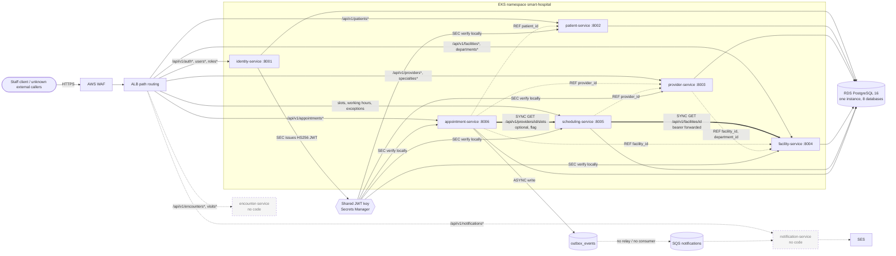

# Smart Hospital — Dependency Mapping and Impact Analysis

Read-only analysis of the nine `UST-HealthCare-Project` repositories, building on
[`cross-repository-discovery.md`](cross-repository-discovery.md) (finding IDs `F-xx` refer to that report).
No source, configuration, infrastructure or pipeline was changed.

**Repositories inspected:** `identity-service`, `patient-service`, `provider-service`, `facility-service`,
`scheduling-service`, `appointment-service`, `smart-hospital-gitops`, `smart-hospital-infra`,
`smart-hospital-architecture`. Encounter and notification services have **no repository and no code**.

**Confidence labels:** **Confirmed** (read directly in code or config), **Strongly indicated** (several pieces of
evidence agree, but there is no direct runtime proof), **Hypothesis** (inferred), **Unknown** (no evidence either way).
**Dependency types:** `SYNC` (synchronous HTTP call), `ASYNC` (event or message), `REF` (stores another service's ID
without calling it), `LIB` (shared or duplicated library or code), `DATA` (shared data store or instance),
`SEC` (security contract), `INFRA` (platform), `EXT` (external system).

Evidence is cited as `repository:path[:lines]`. Line numbers were read on the `main` branch at the time of the split.

---

## 1. Summary

- **Runtime service-to-service calls: exactly two (Confirmed).** scheduling → facility and appointment →
  scheduling. Both are synchronous HTTP/JSON calls that forward the caller's bearer token. No other service has an HTTP
  client: only `scheduling-service:app/clients/facility_client.py` and
  `appointment-service:app/clients/scheduling_client.py` exist.
- **No asynchronous messaging is live (Confirmed).** appointment writes `outbox_events` rows, but no relay, broker
  client or consumer exists in any repository (F-09). SQS and SES are provisioned for a notification-service that has
  no code (F-11).
- **No shared library package (Confirmed).** Cross-cutting code (tokens, roles, logging, errors, config) is copied
  into each service and has drifted (§5). The real shared contracts are the **JWT claim set** and the **shared HS256
  signing key**.
- **No shared database tables (Confirmed).** Each service has its own database, role and Alembic history, but all of
  them run on **one RDS instance** (shared `DATA`/`INFRA` dependency).
- **Patient-service has no runtime consumer in the inspected repositories (Confirmed).** appointment stores
  `patient_id` as an opaque UUID and never calls patient-service. A patient API response change is therefore
  internally **Compatible**, except for changes to the `id` type or format, the route prefix (ALB) and patient-service's
  own tests. External or UI consumers are **Unknown** (§8).

---

## 2. Dependency map (Mermaid)

Legend: `==>` synchronous HTTP call; `-.->` with `REF` = stored ID with no call; dashed nodes have infrastructure only.

---

## 3. Dependency matrix

Criticality: **H** means the capability is down if the dependency fails, **M** means degraded, **L** means cosmetic or none.

| ID | Source → Target | Type | Direction | Protocol / contract | Evidence | Business purpose | Crit. | Likely failure impact | Confidence | Validation action |
|---|---|---|---|---|---|---|---|---|---|---|
| D-01 | scheduling → facility | SYNC | outbound from scheduling | `GET /api/v1/facilities/{id}`, HTTP/JSON, bearer forwarded; reads only `id`, `timezone`, `is_active`; timeout `FACILITY_TIMEOUT_SECONDS` (default 3 s) | `scheduling-service:app/clients/facility_client.py:1-87`; `app/core/config.py:53-54` (`facility_service_url` required); `smart-hospital-gitops:deploy/helm/scheduling-service/values.yaml:51` (`http://facility-service:8004`) | Interpret working hours in the facility's timezone; refuse inactive facilities | H (slot queries) | Facility down or timing out → 503 `ServiceUnavailableError` on slot queries; 404 → facility not found. A change to `timezone` or `is_active` breaks scheduling | Confirmed | Contract test for the three fields; Datadog trace `scheduling-service → facility-service` |
| D-02 | appointment → scheduling | SYNC | outbound from appointment | `GET /api/v1/providers/{id}/slots`, HTTP/JSON, bearer forwarded; reads `slots[].start_utc` and `end_utc` (`SlotsResponse`); 404 → not found, 409 → facility inactive, other statuses → 503 | `appointment-service:app/clients/scheduling_client.py:1-100`; `app/services/appointment_service.py:165-175` (`_advise`); `app/core/config.py:57-61`; `scheduling-service:app/schemas/slot.py:10-28`; `smart-hospital-gitops:deploy/helm/appointment-service/values.yaml:51`, `dev-values.yaml` (`SCHEDULING_ADVICE_ENABLED: "true"`) | Advisory pre-check before book and reschedule | H in dev (flag on); none when flag off | Scheduling or facility down → book and reschedule fail; correctness still rests on the GiST constraint | Confirmed (call); Strongly indicated (fails closed: `_advise` does not catch the client errors) | Integration test with scheduling stubbed to 503; check the flag value per environment |
| D-03 | appointment → facility (transitive, via D-02) | SYNC (indirect) | — | Indirect through scheduling's facility lookup | D-01 + D-02 | Facility validity at booking time | H in dev | Facility outage blocks booking when advice is on | Confirmed | Same as D-02 |
| D-04 | patient, provider, facility, scheduling, appointment → identity | SEC | identity issues; the others verify locally (no runtime call) | JWT HS256/384/512 with `kid`; claims `iss`, `aud`, `sub`, `iat`, `nbf`, `exp`, `jti`, `token_use=access`, `roles`; `iss=https://identity.smart-hospital.local`, `aud=smart-hospital-api` | `identity-service:app/core/tokens.py:14,40-61`; `<svc>:app/core/tokens.py:35-63`; `<svc>:app/core/config.py:44-50`; `smart-hospital-gitops:deploy/helm/*-service/values.yaml:47-49` | Authentication of staff users across all APIs | H | Identity down → no new logins, but tokens already issued remain valid until `exp` (15 min default, `identity-service:app/core/config.py:48`). A claim or key change breaks every verifier at once | Confirmed | Shared claim-contract test; keep the verifier code (§5) aligned |
| D-05 | all 6 services → shared JWT signing key | SEC / INFRA | read at pod start | Secrets Manager `smart-hospital/dev/shared/jwt-signing-key` → ExternalSecret → env `JWT_SECRET_KEY`, `JWT_KEY_ID`; `JWT_PREVIOUS_KEYS` supports rotation | `smart-hospital-infra:infra/terraform/modules/secrets/main.tf:34-49`; `smart-hospital-gitops:deploy/helm/microservice/templates/_externalsecret.tpl:44-51` | Single trust root | H | Key leak from any service allows forging tokens for all of them (F-07). A wrong rotation logs everyone out | Confirmed | Rotation runbook test using `jwt_previous_keys` |
| D-06 | appointment → patient | REF | appointment stores the ID | `patient_id: uuid.UUID` (request and response schema), `Uuid` column, index `ix_appointments_patient_id_starts_at`; **no FK, no call, no existence or active check** | `appointment-service:app/schemas/appointment.py:24,67`; `app/models/appointment.py:21,37,49`; `migrations/versions/0001_create_appointment_tables.py:27,31,59`; `README.md:16,282` | Link a booking to a patient | M | patient-service down: **no effect** on booking. Unknown or inactive patient IDs are accepted (F-05) | Confirmed | Decide whether to validate patients synchronously or via events (discovery open question 3) |
| D-07 | appointment → provider | REF | stores ID | `provider_id` UUID, used in the overlap constraint; no call | `appointment-service:app/models/appointment.py` (`ExcludeConstraint`); `app/schemas/appointment.py` | Provider's calendar integrity | M | Unknown or inactive providers can be booked (F-05) | Confirmed | Same as D-06 |
| D-08 | appointment → facility | REF | stores ID | `facility_id` UUID; validated only indirectly when the D-02 flag is on | `appointment-service:app/models/appointment.py:49-51` | Booking location | M | When the flag is off, no facility validation | Confirmed | — |
| D-09 | scheduling → provider | REF | stores ID | `provider_id` path parameter and column; never validated | `scheduling-service:app/models/working_hours.py`; `app/api/v1/slots.py` | Working hours per provider | M | Schedules for providers that don't exist (F-06) | Confirmed | Contract or event from provider-service |
| D-10 | provider → facility | REF | stores IDs | `facility_id`, `department_id` UUIDs; no client | `provider-service:app/schemas/provider.py:53-54,72-73`; `app/models/provider.py` | Provider's home facility and department | L | Orphan references (F-06) | Confirmed | — |
| D-11 | appointment → (no consumer) | ASYNC (producer only) | outbound, never delivered | Transactional outbox `outbox_events(id, aggregate_type, aggregate_id, event_type, payload JSON, occurred_at, published_at)`; events `AppointmentCreated`, `AppointmentRescheduled`, `AppointmentCancelled`; payload `event_type, appointment_id, patient_id, provider_id, facility_id, starts_at, ends_at, status, version, occurred_at` | `appointment-service:app/models/outbox_event.py:19-31`; `app/services/appointment_service.py:188-230`; `app/domain/appointments.py`; test `tests/test_appointments_api.py:317` (payload keys) | Future notifications and encounters | L today | No consumer, so nothing fails. The table grows without bound (F-09). The event schema is an unpublished contract | Confirmed | Agree on the relay and transport (SQS is provisioned) and publish the schema |
| D-12 | notification-service (absent) → SQS, SES | INFRA / EXT | — | IAM grants `sqs:SendMessage/ReceiveMessage/DeleteMessage…` on queue and DLQ; `ses:SendEmail` | `smart-hospital-infra:infra/terraform/environments/dev/main.tf:28-45,127-140,161` | Planned delivery | L | None today; idle resources (F-11) | Confirmed | — |
| D-13 | 6 services → RDS PostgreSQL 16 | DATA / INFRA | each service uses only its own DB | One DB and one role per service (`identity_db`, `patient_db`…); `DATABASE_URL` from Secrets Manager `smart-hospital/dev/<svc>/database`, `sslmode=require` | `smart-hospital-infra:infra/terraform/environments/dev/terraform.tfvars:37-92`; `modules/secrets/main.tf:3-31`; `_externalsecret.tpl:44` | Persistence | H | Instance down → all six services fail `/health/ready` and all writes. Single-AZ `db.t3.micro` (F-18) | Confirmed | Confirm no cross-database grants with `\dp` per role |
| D-14 | db-bootstrap job → RDS master secret | DATA / SEC | outbound | psql `CREATE ROLE` / `CREATE DATABASE` per service, master credentials via ExternalSecret | `smart-hospital-gitops:deploy/helm/db-bootstrap/templates/job.yaml:43-48`; `templates/externalsecret.yaml:36-40`; `dev-values.yaml:10` | Provision per-service databases | H (first deploy) | A failure blocks the first deployment of a new service | Confirmed | — |
| D-15 | each service → own Alembic migrations (Argo CD hook) | INFRA | — | Job `alembic upgrade head`, `argocd.argoproj.io/hook: Sync`, `sync-wave: "-1"` | `smart-hospital-gitops:deploy/helm/microservice/templates/_migrationjob.tpl:10-12` | Schema before rollout | H | A failed migration blocks that service's rollout only | Confirmed | — |
| D-16 | 6 service charts → `microservice` library chart | LIB (Helm) | consumed by every chart | Templates: Deployment, NodePort Service, IRSA ServiceAccount, ConfigMap, ExternalSecret, migration Job | `smart-hospital-gitops:deploy/helm/microservice/templates/*.tpl` | Uniform deployment | H | A chart change rolls out to all six services at once | Confirmed | `helm template` diff for all six before merging |
| D-17 | ALB (+WAF) → services | INFRA | inbound | Path-pattern rules to NodePorts 30081-30086; health check path per service | `smart-hospital-infra:.../dev/terraform.tfvars:37-92`; `modules/alb/main.tf:4-10,78-79`; `modules/waf` | Only external entry point | H | ALB or WAF outage → all APIs unreachable. Path rules couple routes to services (§8) | Confirmed | — |
| D-18 | Argo CD → `smart-hospital-gitops` (after cutover) / monorepo (today) | INFRA | pull | App of apps + ApplicationSet over `deploy/helm/*-service` | `smart-hospital-gitops:deploy/argocd/apps/values.yaml:1`; `deploy/argocd/root-app.yaml:12`; `apps/templates/microservices.yaml` | Continuous delivery | H (for change) | Repo or Argo CD outage → no deploys; running pods unaffected | Confirmed (config); the cutover branch `devin/1793640500-cicd-rewire` is not merged | Verify the `repoURL` in the live Application after cutover |
| D-19 | service CI → ECR → gitops | INFRA / EXT | push | GitHub OIDC → role `smart-hospital-dev-github-actions` → ECR `smart-hospital/<svc>:<sha12>` → `image.tag` commit | monorepo `.github/workflows/build-push.yml` (live); service repos `build-push.yml` on unmerged branch `devin/1793640500-cicd-rewire`; `smart-hospital-infra:modules/github-oidc/main.tf` | Image delivery | M | No new releases; running services unaffected | Confirmed | — |
| D-20 | pods → External Secrets Operator + Secrets Manager (IRSA) | INFRA / SEC | pull at start and refresh | ExternalSecret per service; IRSA role per service | `_externalsecret.tpl`; `smart-hospital-infra:modules/service-irsa`; `dev-values.yaml` `serviceAccount.roleArn` | Secret delivery | H at pod start | ESO or Secrets Manager failure → new pods can't start; running pods keep their env | Confirmed | — |
| D-21 | 6 services → Datadog | EXT | push | Datadog Agent + Single Step Instrumentation; SLOs, monitors and dashboards keyed by `service:<name>` | `smart-hospital-gitops:deploy/datadog`, `deploy/helm/datadog-secrets`; `smart-hospital-infra:modules/datadog-observability/slos.tf:7-33`, `dashboards/service-slo.json.tftpl:123-138,486-508` | Observability | L (runtime), M (operations) | Loss of telemetry only. Renaming a service breaks its SLO queries | Confirmed | — |
| D-22 | services → each other's role names | SEC / LIB (duplicated) | — | `Role` enum `ADMIN, RECEPTIONIST, DOCTOR, READ_ONLY` duplicated; each service has its own permission map | `patient-service:app/domain/roles.py:11-35`; `<svc>:app/domain/roles.py` (all checksums differ) | Authorization | H | A role added or renamed in identity is unknown to the other services (default deny) | Confirmed | Shared roles contract test |

---

## 4. Synchronous vs asynchronous vs shared data vs shared code

| Category | Present? | Instances |
|---|---|---|
| Synchronous calls | Yes, 2 | D-01, D-02 (D-03 transitive). Both HTTP/JSON over Kubernetes DNS, forwarding the user's token (no service identity, F-08) |
| Asynchronous events | Producer only | D-11 outbox (no relay, no consumer). No broker client in any service |
| Shared data access | No shared tables | Separate databases and roles on **one shared RDS instance** (D-13). Cross-service references are opaque UUIDs (D-06 to D-10) |
| Shared libraries | No package | Duplicated code (§5), the shared Helm library chart (D-16) and shared Terraform modules |

---

## 5. Shared libraries and versions

**Third-party pins (Confirmed, `<svc>/requirements.txt`).** These are identical across all six services: `fastapi==0.143.1`,
`uvicorn[standard]==0.54.0`, `pydantic==2.14.1`, `pydantic-settings==2.16.0`, `SQLAlchemy==2.1.4`, `alembic==1.20.0`,
`psycopg[binary]==3.3.6`, `PyJWT==2.15.1`.

| Package | identity | patient | provider | facility | scheduling | appointment |
|---|---|---|---|---|---|---|
| `httpx==0.28.1` | | | | | yes (client) | yes (client) |
| `tzdata==2026.3` | | | | yes | yes | yes |
| `email-validator==2.3.0` | yes | yes | yes | yes | | |
| `argon2-cffi==25.1.0` | yes | | | | | |

**Duplicated in-repo code (Confirmed, md5 of `app/core/tokens.py`):** provider, facility, scheduling and appointment
are identical (`d2b91957`). patient differs (`10cf7fbe`); identity differs (`7c910d70`, as the issuer). All six
`app/domain/roles.py` files differ, which is expected because each holds its own permission map. Config validation
(`MIN_SECRET_BYTES_BY_ALGORITHM`, placeholder detection) and JSON logging are copied into every service. Because the
repositories are now separate, **a claim or validation change needs six coordinated PRs** (F-10).

**Platform "libraries":** the Helm chart `microservice` (D-16); Terraform modules `vpc, iam, ecr, eks, rds, secrets,
sqs, ses, s3, service-irsa, datadog, github-oidc, acm, alb, waf` (`smart-hospital-infra:.../dev/main.tf:51-255`);
GitHub Actions `actions/checkout@v4`, `setup-python@v5`, `aws-actions/configure-aws-credentials@v4`,
`amazon-ecr-login@v2`, `docker/build-push-action@v6`; and the gitleaks image `v8.21.2`.

---

## 6. Critical dependency list

| Rank | Dependency | Why critical |
|---|---|---|
| 1 | D-05 shared JWT key | One secret authenticates every API; compromise or a bad rotation affects all six services |
| 2 | D-13 single RDS instance | All persistence on one single-AZ `db.t3.micro` |
| 3 | D-17 ALB + WAF | Only ingress; path rules bind API prefixes to services |
| 4 | D-04 identity token contract | Every verifier depends on the claim set, `iss`, `aud`, `kid` and algorithm |
| 5 | D-02 / D-03 scheduling + facility for booking | With `SCHEDULING_ADVICE_ENABLED=true` (dev), booking availability depends on two more services |
| 6 | D-01 facility for slots | Slot queries fail without facility |
| 7 | D-16 Helm library chart | One change rolls out to all services |
| 8 | D-20 ESO / Secrets Manager / IRSA | Pods can't start without them |
| 9 | D-18 / D-19 GitOps + CI/CD | Change delivery (not runtime) |

## 7. Potential single points of failure

| SPOF | Scope of outage | Evidence | Confidence | Mitigation to evaluate |
|---|---|---|---|---|
| RDS instance (single AZ) | All services | tfvars RDS settings (F-18) | Confirmed | Multi-AZ, backups and restore drill |
| Shared HS256 key | All authentication | D-05 | Confirmed | Per-service verification with asymmetric keys and JWKS (F-07) |
| identity-service | New logins only; existing tokens work for up to 15 min | D-04 | Confirmed | Replicas > 1 (dev uses `replicaCount: 1`) |
| facility-service | Slot queries; booking when the advice flag is on | D-01, D-03 | Confirmed | Cache the facility timezone; circuit breaker |
| scheduling-service | Booking and rescheduling when the advice flag is on | D-02 | Strongly indicated | Fail-open policy decision; the GiST constraint already guarantees correctness |
| Single replica per service | Each service | `deploy/helm/*/dev-values.yaml` `replicaCount: 1` | Confirmed | PodDisruptionBudget and ≥2 replicas outside dev |
| Spot-only node group | All pods during reclaim | tfvars (F-18) | Confirmed | Mixed on-demand capacity |
| ALB / WAF | All external traffic | D-17 | Confirmed | Managed service; monitor 5xx |
| `smart-hospital-gitops` repo / Argo CD | Deployments only | D-18 | Confirmed | — |

---

## 8. Scenario: patient-service changes an API response field or version

### 8.1 Patient API surface (producer)

| Endpoint | Response schema | Evidence |
|---|---|---|
| `POST /api/v1/patients` | `PatientRead` (201) | `patient-service:app/api/v1/patients.py:24-26` |
| `GET /api/v1/patients` | `Page[PatientSummary]` → `id, medical_record_number, first_name, last_name, date_of_birth, sex, is_active` | `patients.py:35`; `app/schemas/patient.py:81-92` |
| `GET` / `PATCH /api/v1/patients/{id}`, `POST …/deactivate` | `PatientRead` = summary + `phone, email, address_line1/2, city, state, postal_code, country, created_at, updated_at` | `patients.py:57-81`; `schemas/patient.py:95-105` |
| `/health`, `/health/ready` | `{"status": …, "database": …}` | `app/api/health.py:11-16` |

Versioning: the URL prefix is `API_V1_PREFIX = "/api/v1"` (`app/main.py:20,50`), and the OpenAPI `version="0.1.0"`
(`app/main.py:35`). There is no header-based versioning and no published OpenAPI artifact.

### 8.2 Consumer search: what was inspected and what was found

| Place inspected | Result | Confidence |
|---|---|---|
| HTTP clients in all service repos (`app/clients/`) | Only `facility_client.py` (scheduling) and `scheduling_client.py` (appointment). **No patient client** | Confirmed |
| Config and env (`app/core/config.py`, `.env.example`, Helm `values.yaml`/`dev-values.yaml`) | No `PATIENT_SERVICE_URL` or similar anywhere | Confirmed |
| Schemas in other services | `appointment-service:app/schemas/appointment.py:24,67`: `patient_id: uuid.UUID` only | Confirmed |
| Models and migrations | `appointment-service:app/models/appointment.py:49`, migration `0001…:31,59`: UUID column + index, no FK | Confirmed |
| Events | Outbox payload `patient_id` as a string (`appointment_service.py:219`); no consumer | Confirmed |
| Tests and mocks in consumers | `appointment-service` tests use random `uuid4()` patient IDs (`tests/conftest.py:152`, `test_appointments_api.py:115-131`). **No patient-service stub or mock exists** | Confirmed |
| Producer tests | `patient-service:tests/test_patients_api.py:18-23` (expected key set), `:54` (MRN regex), `:60`; `tests/test_migrations.py:20-33` | Confirmed |
| Generated SDKs / contract tests (Pact, openapi-generator) | None found in any repository | Confirmed |
| Ingress | ALB rule `path_patterns = ["/api/v1/patients*"]` → NodePort 30082 (`smart-hospital-infra:.../dev/terraform.tfvars:44-48`; `infra/terraform/README.md:91`) | Confirmed |
| Deployment | `deploy/helm/patient-service/values.yaml:4,8` (port 8002, NodePort 30082), probes from `_deployment.tpl:63-69`, `dev-values.yaml` | Confirmed |
| Observability | Datadog SLOs and dashboards keyed by `service:patient-service`, not by route (`slos.tf:7-33`; `service-slo.json.tftpl:123-138,486-508`) | Confirmed |
| Docs | `patient-service:README.md:110-145` (API table, summary fields); the Care Points test plan (`smart-hospital-architecture:docs/testing/care-points/test-plan.md:32,83,173`) proposes a **new** `GET /api/v1/patients/{id}/points` route | Confirmed (text) |
| Frontend, API gateway, external partners | No repository exists (future scope in `AGENTS.md`). Callers through the ALB are not inventoried | **Unknown** |

### 8.3 Impact classification by change type

| Change in patient-service | appointment-service | Other services | Infra / deploy / observability | patient-service tests and docs | External / UI callers | Overall |
|---|---|---|---|---|---|---|
| Add an optional response field | Compatible (doesn't read responses) | Compatible | Compatible | Update the key-set assertion (`test_patients_api.py:18-23`) and README | Compatible for tolerant readers | **Compatible** |
| Remove or rename a field (e.g. `medical_record_number`, `is_active`) | Compatible | Compatible | Compatible | Tests fail by design → update | **Breaking** for any reader of that field | **Breaking** (external), **Unknown** consumer set |
| Change the type or format of `id` (UUID → string or int) | **Breaking**: `patient_id: uuid.UUID` validation (422), the `Uuid` column, stored data and the outbox payload | Compatible | Compatible | Tests and migrations change | Breaking | **Breaking** |
| Change `is_active` semantics (e.g. a status enum) | Compatible today. **Potentially breaking** if booking starts validating patients (F-05, open question 3) | Compatible | Compatible | Tests change | Potentially breaking | **Potentially breaking** |
| Change summary vs full projection (list returns more or fewer fields) | Compatible | Compatible | Compatible | Tests change | Potentially breaking; adding contact or DOB to list responses is a privacy regression (`AGENTS.md` minimum-fields rule) | **Potentially breaking** |
| Add `/api/v2/patients` alongside v1 | Compatible | Compatible | **Operational**: the ALB pattern `/api/v1/patients*` doesn't match `/api/v2/…`, so add a rule (tfvars `path_patterns`) and check WAF rules. Datadog keeps working (keyed by service) | README and tests | Compatible while v1 stays | **Operational** |
| Remove `/api/v1/patients` (v2 only) | Compatible | Compatible | Operational (update the ALB rule) | — | **Breaking** | **Breaking** |
| Change the error format or status codes | Compatible | Compatible | Datadog error SLI counts 5xx only, so a 4xx→5xx shift moves the SLO | Tests change | Potentially breaking | **Potentially breaking** |
| Change permissions (e.g. DOCTOR loses `patients:read`) | Compatible | Compatible | — | `roles.py:24-27` and tests | Breaking for affected roles | **Potentially breaking** |
| Rename the service or its port | Compatible | Compatible | **Operational**: Helm chart, ApplicationSet path `deploy/helm/*-service`, NodePort/ALB target, ECR repo, IRSA role, DB secret name, Datadog SLO `service:` tags | — | — | **Operational** |
| Add `GET /api/v1/patients/{id}/points` hosted by **appointment-service** (Care Points proposal) | New owner | — | **Operational, Strongly indicated as a conflict:** the ALB sends every `/api/v1/patients*` request to patient-service, so this route would never reach appointment-service unless a higher-priority rule is added | — | — | **Operational** (needs a routing decision) |

### 8.4 Recommended validation actions

1. **Find real callers before any breaking change:** query Datadog `trace.fastapi.request.hits{service:patient-service}`
   by `resource_name` and client (and ALB access logs, if enabled) for 2–4 weeks. Right now the consumer set outside
   the repositories is **Unknown**.
2. **Publish the contract:** export `openapi.json` from patient-service in CI, and diff it on every PR (an
   oasdiff-style breaking-change check).
3. **Add consumer-side contract tests** if a patient client is introduced (e.g. for F-05 validation), following the
   narrow-client pattern of `facility_client.py` (read only the fields you need).
4. **Treat `id` as frozen:** a UUID is the only cross-service contract with stored copies (appointment rows and outbox).
5. **Resolve the `/api/v1/patients/{id}/points` routing ownership** before implementing Care Points.

---

## 9. Open questions and evidence gaps

| # | Question / gap | Status |
|---|---|---|
| G-1 | Who calls the APIs through the ALB (UI, scripts, partners)? No traffic data was inspected | Unknown |
| G-2 | Does booking fail closed when scheduling returns 503? The code path shows no catch, but no test was run for this analysis | Strongly indicated |
| G-3 | Will the outbox event schema be versioned (`event_type` only, with no `schema_version` field)? | Unknown |
| G-4 | Are there cross-database grants on RDS? Not checked live; only the bootstrap SQL was read | Hypothesis: none |
| G-5 | Which Terraform root (`dev` or `clinical-platform`) is authoritative (F-14)? | Unknown |
| G-6 | Cutover status: the CI/CD and Argo CD rewiring branches (`devin/1793640500-cicd-rewire`) are not merged; the live system still runs from the monorepo | Confirmed (at time of writing) |
