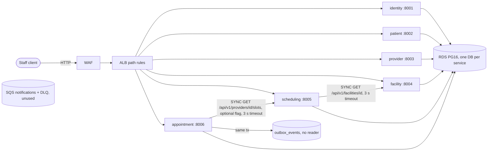

# Current-State Architecture (governed workflow — evidence pack, part 2/4)

Steps **C–I** of the fixed sequence. Every row cites an evidence ID from [`evidence-register.md`](evidence-register.md) (`E-nn`).
Repository IDs (R0–R9) and component IDs (C1–C15) are defined in [`repository-inventory.md`](repository-inventory.md).
No technology choice is proposed here.

## C. API, event, queue and integration contracts

| Contract | Producer → consumer | Type | Evidence | Class / confidence |
|---|---|---|---|---|
| REST `/api/v1/auth/{login,me}`, `/users`, `/roles` | C1 → clients | Sync HTTP/JSON | E-01 | CODE High |
| REST `/api/v1/patients` (5 operations) | C2 → clients | Sync | E-02 | CODE High |
| REST `/api/v1/providers` (6), `/specialties` (3) | C3 → clients | Sync | E-03 | CODE High |
| REST `/api/v1/facilities` (8), `/departments` (4) | C4 → clients, C5 | Sync | E-04 | CODE High |
| REST working hours (4), exceptions (4), `GET /providers/{id}/slots` | C5 → clients, C6 | Sync | E-05 | CODE High |
| REST `/api/v1/appointments` (8 operations) | C6 → clients | Sync | E-06 | CODE High |
| `/health`, `/health/ready` (`SELECT 1`) in all six | each → probes | Sync | E-07 | CODE High |
| Facility lookup (reads `id`, `timezone`, `is_active`) | C5 → C4 | Sync client, bearer forwarded | E-08 | CODE High; MOCK `FakeFacilityClient` in tests (E-40) |
| Slot advice (reads `slots[].start_utc/end_utc`) | C6 → C5 | Sync client, optional | E-09 | CODE High; MOCK `FakeSchedulingClient` (E-41) |
| Outbox events `AppointmentCreated/Rescheduled/Cancelled` | C6 → (nobody) | Async, producer only | E-10 | CODE High |
| SQS queue `smart-hospital-dev-notifications` + DLQ | defined for C8 | Queue | E-11 | CONFIG High; LIVE exists (deployed stack) |
| SES identity | C8 (planned) | External | E-12 | CONFIG High; not created (no domain) |
| No OpenAPI artifact, schema registry, SDK or contract tests | — | — | E-42 | Absence: High |

## D. Data stores, source of truth, read/write paths and ownership

| Data | Source of truth (owner) | Write path | Read path | Evidence | Confidence |
|---|---|---|---|---|---|
| Users, password hashes, roles | C1 `users` | `/api/v1/users` (admin), `cli seed-demo-users` | `/auth/login`, `/auth/me` | E-13 | High |
| Patients (demographics, contact) | C2 `patients` | POST/PATCH `/patients` | GET `/patients[/{id}]`; **no service reads it** | E-14 | High |
| Providers, specialties | C3 | POST/PATCH | GET; **no service reads it** | E-15 | High |
| Facilities, departments, rooms | C4 | POST/PATCH | GET; C5 reads 3 fields | E-16 | High |
| Working hours, exceptions | C5 | POST/PATCH/DELETE | slot computation | E-17 | High |
| Appointments + outbox | C6 | book/reschedule/cancel/transitions; outbox row in the same transaction | GET; outbox unread | E-18 | High |
| Cross-service references | IDs only (UUID), **no FKs, no existence checks** | — | — | E-19 | High |
| Physical store | one RDS PostgreSQL 16 instance, single-AZ, 7-day backups, `rds.force_ssl` | — | — | E-20 | CONFIG High; LIVE exists |
| Concurrency control | C6 GiST exclusion `ex_appointments_provider_overlap` + `version_id_col`; C1/C2 `with_for_update` | — | — | E-21 | CODE High |

## E. Deployment, runtime and infrastructure configuration

| Item | Current state | Evidence | Class |
|---|---|---|---|
| Delivery path | Monorepo CI `build-push.yml` → ECR `smart-hospital/<svc>:<sha12>` → commit `image.tag` → Argo CD (monorepo `main`) → EKS | E-22 | CONFIG High |
| Live revision | Argo CD root and child apps on `main` of R0 (`dbb032e`); 11 apps Synced/Healthy; images `5f077cdb0217` | E-23 | LIVE High (2026-11-03) |
| Runtime | EKS 1.34; 2× spot t3.medium/t3a.medium; namespace `smart-hospital`; `replicaCount` 2 base / **1 in dev** | E-24 | CONFIG High |
| Pod resources | requests 50m / 128Mi, limits 500m / 384Mi (patient-service example) | E-25 | CONFIG High |
| Migrations | Argo CD Sync hook Job `alembic upgrade head`, sync-wave −1 | E-26 | CONFIG High |
| Exposure | ALB path routing to NodePorts 30081–30086 (HTTP, no domain); Argo CD via Classic LB (`server.service.type: LoadBalancer`) | E-27 | CONFIG + LIVE High |
| Second platform root | `clinical-platform` defined, not deployed | E-28 | CONFIG High / LIVE High |

## F. Security, identity, network and secrets patterns

| Pattern | Current state | Evidence | Class |
|---|---|---|---|
| Authentication | HS256 JWT from C1 (`iss`, `aud`, `kid`, `token_use`, `roles`); local verification in C2–C6 | E-29 | CODE High |
| Authorization | Per-service permission maps (e.g. `patients:read/write/deactivate`); `require_permission` dependency; default deny | E-30 | CODE High |
| Service identity | None. C5 and C6 forward the end user's bearer token | E-08, E-09 | CODE High |
| Signing key | One shared secret `smart-hospital/dev/shared/jwt-signing-key` for all services; `JWT_PREVIOUS_KEYS` rotation support | E-31 | CONFIG + CODE High |
| Secret hygiene | Config rejects placeholder secrets and short keys (`MIN_SECRET_BYTES_BY_ALGORITHM`) | E-32 | CODE High |
| Secret delivery | ESO + IRSA per service from Secrets Manager; no secrets in Git (gitleaks in monorepo CI) | E-33 | CONFIG High |
| Network | EKS API public, limited to `140.232.64.0/26`; ALB open `0.0.0.0/0` on HTTP; WAF rate limit + AWS managed rules | E-34 | CONFIG High |
| Data in transit | RDS `rds.force_ssl`; DB URL `sslmode=require`; **ALB is HTTP only** | E-20, E-35 | CONFIG High |
| Container | Non-root `USER 10001`; `securityContext` blocks in the library chart | E-36 | CONFIG High |

## G. Reliability: timeout, retry, idempotency, circuit breaker and fallback

| Mechanism | Current state | Evidence | Class |
|---|---|---|---|
| Timeouts | HTTP client timeouts default 3 s (max 30) for both sync clients | E-37 | CODE High |
| Retries | **None** in service code (no retry/backoff library or loop); only "retry the request" error messages | E-38 | CODE High (absence) |
| Circuit breaker | **None** | E-38 | CODE High (absence) |
| Fallback | Scheduling advice is optional (`SCHEDULING_ADVICE_ENABLED`, default false, **true in dev**); when on, upstream errors map to 404/409/503 (fail closed) | E-09, E-39 | CODE + CONFIG High |
| Idempotency | No idempotency keys on any POST. Demo seeding is idempotent. Booking conflicts rely on DB constraints + optimistic version | E-38, E-21 | CODE High |
| DB connection | `pool_pre_ping=True`; default pool sizes | E-43 | CODE High |
| Kubernetes | Liveness `/health`, readiness `/health/ready`; Argo CD self-heal, retry limit 10 | E-07, E-44 | CONFIG High |

## H. Observability, SLOs, alerting and runbooks

| Item | Current state | Evidence | Class |
|---|---|---|---|
| Logs | Structured JSON logging; request-ID middleware (`X-Request-ID`); rules forbid logging tokens, PHI and bodies | E-45 | CODE High |
| Traces / metrics | Datadog Agent + Single Step Instrumentation (APM injected; no tracing code) | E-46 | CONFIG High |
| SLOs | Per service: availability target 99.5 % (30d/7d), latency p95 ≤ 500 ms target 99.5 % (Terraform module defaults) | E-47 | CONFIG High; whether they're live in Datadog is DOC only (dashboards created via API) |
| Alerting | Datadog monitors: SLO burn rate, latency budget, unavailable replicas, restarts, node CPU/memory, error logs | E-48 | CONFIG High |
| Runbooks | Rollout/rollback in `deploy/README.md`; rollback rules in `docs/workflow/governed-sdlc.md` §5; appointment README rollback section. **No incident runbooks** for DB, queue or auth outages | E-49 | DOC High |

## I. Tests

| Type | Current state | Evidence | Class |
|---|---|---|---|
| Unit + API | 415 test functions across 51 files (C1 78, C2 53, C3 65, C4 65, C5 88, C6 66); FastAPI TestClient; SQLite by default | E-50 | TEST High |
| Integration (DB) | Same suites against PostgreSQL via `TEST_DATABASE_URL`; Alembic up/down/up + `alembic check` in monorepo CI | E-51 | TEST + CONFIG High |
| Concurrency | `appointment-service/tests/test_concurrency_postgres.py` (PostgreSQL only) | E-52 | TEST High |
| Client contract | HTTP clients tested with `httpx.MockTransport` handlers; fakes replace upstreams in the API tests | E-40, E-41 | MOCK High; **no provider-side contract test** |
| Infrastructure | `terraform test` with mocked providers (3 runs) | E-53 | TEST High |
| Load / performance | **None found** (no locust, k6 or benchmark) | E-42 | Absence High |
| Resilience / chaos | **None in repositories** | E-42 | Absence High |
| End-to-end | Manual smoke script only (outside the repositories) | E-54 | LIVE Medium |
