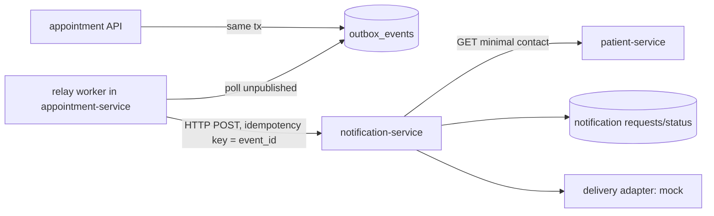
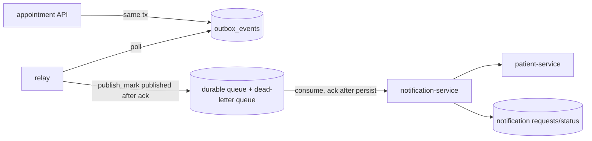
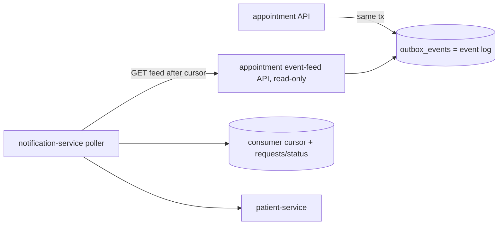
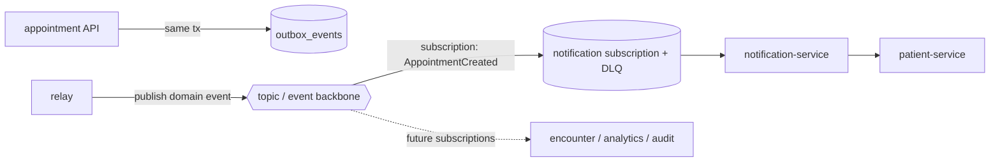

# Option Set: Booking Notification Communication

| Field | Value |
|---|---|
| Inputs | `decision-brief.md` (DB-001, Q1–Q12, drivers D1–D12), `current-state-architecture.md` + `evidence-register.md` (`E-nn`), `evidence-validation-report.md` (`V-nn`, blocking gaps B-1–B-6) |
| Purpose | A balanced set of credible options. **No option is selected.** Options are described as architecture patterns, not products |
| Status | Draft for review. Scoring waits for the agreed weights and targets (B-1) |

## 0. Common baseline and shared prerequisites

**Current state (Verified):**
- appointment-service writes `AppointmentCreated/Rescheduled/Cancelled` rows to `outbox_events` in the booking
  transaction (E-10, V-06).
- Nothing reads them.
- There is no notification-service (C8).
- No retries, circuit breakers or idempotency keys exist in code (V-17).
- Contact data lives only in patient-service (E-14).
- Background callers have no service identity (V-03, V-04: the user's token is forwarded).

**Every option needs these.** They are listed once so the options can be compared fairly:

| # | Prerequisite | Evidence |
|---|---|---|
| P-1 | Add `event_id` (= outbox row id) and `schema_version` to the event payload | E-10; ARB C-2 |
| P-2 | A notification capability with its own store of notification requests and status, a mock delivery adapter, and dedupe on `event_id` | `AGENTS.md:35`; `Smart_Hospital_Repository_Rules.md:49` |
| P-3 | A service identity so notification can read minimal contact data from patient-service | V-03/V-04; brief Q7 |
| P-4 | A backlog policy for rows written before activation (watermark) | ARB H-2 |
| P-5 | Agreed targets (latency, volume, loss/duplicate tolerance, RPO/RTO) | B-1 |
| P-6 | Monitoring of event lag, failures and dead items | V-22 (no such monitors exist) |

The baseline **O0, "do nothing"** (keep writing outbox rows, send nothing), is kept as the comparison point. It
doesn't meet the business outcome (brief §1.1).

---

## Option 1 — Retain and improve: outbox + in-service relay + synchronous push to notification

**Logical architecture.**
- A relay inside appointment-service (a background worker in the same deployable) polls unpublished outbox rows.
- It calls notification-service's HTTP endpoint (`POST /api/v1/notifications`) with `event_id` as the idempotency
  key.
- On a success response it marks the row published. On failure it retries with backoff, and the row stays
  unpublished.

| Aspect | Description |
|---|---|
| Components | Relay worker (new, in appointment); notification-service (P-2); contact client (P-3) |
| Request/data flow | Booking commit → row → relay → sync HTTP → notification persists the request → adapter |
| Source of truth | Event: `outbox_events` (appointment DB). Request/status: notification store |
| What changes | appointment gains a worker, retry logic and a client; notification gains a write API |
| Prerequisites | P-1–P-6; multi-replica relay coordination (row locking) because base `replicaCount` is 2 (E-24) |
| Migration / rollback | **Low**. Turn the relay on or off with a flag; unpublished rows stay for later (no loss) |
| Security | Reuses HTTP + JWT patterns; needs the service identity for relay → notification and notification → patient (P-3) |
| Operations | No new platform component; failures are visible as outbox backlog (custom metric needed, P-6) |
| Benefits | Smallest change; same pattern as the existing sync clients (E-08, E-09); the outbox already guarantees no loss at commit |
| Compromises | Point-to-point coupling: every new consumer is another client in appointment. Backpressure handling is hand-written. Relay throughput is bounded by appointment's DB and pods |
| Risks | Retry storms against notification; relay bugs are inside a patient-facing service; head-of-line blocking on poison rows |
| Evidence | E-10, E-21, E-24, E-37, V-17 |
| Assumptions | Demo-scale volume; a delay of minutes is acceptable (brief Open) |
| Unknowns | Volume and latency targets (B-1); relay placement policy (brief Q6/Q8 equivalents) |

## Option 2 — Incremental: outbox + relay + durable point-to-point message queue

**Logical architecture.**
- The relay publishes outbox rows to a durable point-to-point message queue.
- Its features: at-least-once delivery, a visibility/lease timeout, redelivery and a dead-letter queue.
- notification-service consumes from the queue, dedupes on `event_id` and acknowledges after persisting.

| Aspect | Description |
|---|---|
| Components | Relay; queue + DLQ; consumer in notification-service |
| Request/data flow | Booking commit → row → relay → queue → consumer → store → adapter |
| Source of truth | Event: outbox until acknowledged by the queue; then the queue holds it until consumed; request/status: notification store |
| What changes | A queue becomes part of the platform; the relay gets a publisher; notification gets a consumer |
| Prerequisites | P-1–P-6; approval to add a broker (`AGENTS.md:35,60`); queue retention ≥ the recovery window (ARB H-3); a queue policy that keeps the TLS-only rule (ARB H-4) |
| Migration / rollback | **Medium**. The relay flag stops publishing; consumers can be paused while the queue buffers; rollback is bounded by queue retention (default 4 days on the provisioned queue, E-11) |
| Security | Identity-based queue access (least privilege); messages carry IDs only; encryption at rest on the queue (E-11) |
| Operations | New operational surface: depth, age, DLQ count and redrive runbook. The queue resources already exist in the infrastructure code (E-11) |
| Benefits | Buffers notification outages; built-in redelivery and dead-lettering; consumers scale independently of booking |
| Compromises | No fan-out without more queues; ordering isn't guaranteed (consumer must use `version`); two at-least-once hops |
| Risks | Visibility timeout (60 s default) shorter than consumer work leads to duplicates (ARB M-5); messages that expire past retention are lost |
| Evidence | E-10, E-11, V-07 |
| Assumptions | The platform team accepts one more managed component |
| Unknowns | Throughput limits and cost (needs provider validation); whether fan-out is needed (brief Q2) |

## Option 3 — Materially different: consumer-pull change feed (no intermediary)

**Logical architecture.**
- appointment-service exposes a read-only, paginated **event feed API** over its outbox (e.g.
  `GET /api/v1/appointment-events?after=<cursor>`).
- notification-service polls the feed, stores its own cursor and processes events idempotently.
- There is no relay and no broker. Each consumer owns its position.

| Aspect | Description |
|---|---|
| Components | Feed endpoint in appointment; poller and cursor store in notification |
| Request/data flow | Booking commit → row; the consumer pulls batches in commit order and advances its cursor after persisting |
| Source of truth | Event log: `outbox_events` (now retained as a log, not a queue); cursor: consumer-owned |
| What changes | The outbox becomes a published, versioned read contract with a retention policy; `published_at` is no longer the delivery marker |
| Prerequisites | P-1–P-6; a monotonic ordering key (commit-ordered sequence) because timestamps can tie; a feed authorization role for service callers |
| Migration / rollback | **Low–Medium**. Disabling the poller stops delivery with no loss, as long as feed retention covers the pause |
| Security | A new read API exposing event IDs (IDs only); service identity required (P-3) |
| Operations | No new platform component; lag = head sequence minus consumer cursor (easy to measure); feed load lands on appointment's DB |
| Benefits | No broker; natural replay (reset the cursor); per-appointment ordering possible via the sequence; easy to add consumers |
| Compromises | Polling latency and load; every consumer reimplements polling and cursors; appointment's DB becomes an integration point |
| Risks | Feed retention vs consumer downtime; heavier read load on single-AZ RDS (E-20); ordering-key correctness |
| Evidence | E-10, E-18, E-20 |
| Assumptions | Read load at demo scale is acceptable |
| Unknowns | Volume (B-1); appointment owner's willingness to host a public event contract |

## Option 4 — Materially different: publish/subscribe event backbone

**Logical architecture.**
- The relay publishes domain events to a **topic** on a shared publish/subscribe backbone, with content-based
  routing.
- Each subscriber (notification now; encounter, analytics or audit later) gets its own durable subscription with a
  retry policy and dead-letter queue.

| Aspect | Description |
|---|---|
| Components | Relay; topic + routing rules; per-subscriber durable subscription + DLQ |
| Request/data flow | Booking commit → row → relay → topic → routed to subscriptions → consumers |
| Source of truth | Event: outbox until published; subscriptions then hold delivery state |
| What changes | A platform-wide event contract and schema governance; subscriptions managed per consumer |
| Prerequisites | P-1–P-6; schema versioning and ownership (ARB M-9); broker approval (`AGENTS.md:35,60`) |
| Migration / rollback | **Medium–High**. More moving parts (topic, rules, subscriptions); rollback disables the rule or relay; bounded by subscription retention |
| Security | Identity-based publish/subscribe permissions per service; topic-level encryption; a schema registry or contract repo |
| Operations | The largest new surface: routing rules, subscriptions, DLQs per consumer, replay or archive policy |
| Benefits | Fan-out without changing the producer; future consumers decoupled; central event governance |
| Compromises | Ordering not guaranteed; extra hop; higher governance cost for a single consumer today |
| Risks | Over-engineering for one consumer; lock-in to whatever backbone is chosen; harder debugging across hops |
| Evidence | E-10; dependency map D-11 (no consumers today) |
| Assumptions | More consumers will follow (encounter Phase 7 is planned; `AGENTS.md:27`) |
| Unknowns | Whether fan-out is a requirement (brief Q2); cost and quotas (provider validation) |

## Option 5 — Hybrid: different paths for different workload classes (conditional)

Applies **only if** the product owner confirms different classes (brief Q2/Q3). For example:
- (a) the **booking confirmation** must be near-real-time and must not be lost;
- (b) **reminders and digests** are time-scheduled and tolerate batch delay.

| Class | Path |
|---|---|
| (a) Transactional events (create, reschedule, cancel) | Outbox → relay → durable queue (as in Option 2) or feed (as in Option 3) |
| (b) Scheduled notifications (reminders) | notification-service runs a scheduled job that reads upcoming appointments through a read API (sync, batch) and writes its own requests |

| Aspect | Description |
|---|---|
| Benefits | Each class gets the guarantees it needs; reminder load doesn't compete with confirmations |
| Compromises | Two mechanisms to build and operate; a new appointment read API for upcoming bookings |
| Risks | Duplicate messages across classes without a shared dedupe key |
| Unknowns | Whether reminders are in scope at all (brief §3 "Open") |

---

## Comparison summary (descriptive, not scored)

| Dimension | O0 | O1 sync push | O2 queue | O3 pull feed | O4 pub/sub | O5 hybrid |
|---|---|---|---|---|---|---|
| Booking isolation (D1) | Yes | Yes (relay out of band) | Yes | Yes | Yes | Yes |
| No silent loss (D2) | **No delivery** | Outbox + retries | Outbox + queue + DLQ | Log retention + cursor | Outbox + subscription DLQ | Per class |
| Duplicates / idempotency (D3) | n/a | Idempotency key | Consumer dedupe | Cursor + dedupe | Consumer dedupe | Per class |
| Ordering per appointment (D4) | n/a | Per relay order; lost on retry | Not guaranteed | Possible via sequence | Not guaranteed | Per class |
| New platform component | No | No | Yes (queue) | No | Yes (backbone) | Depends |
| Fan-out to future consumers | — | Poor | Poor | Good (each consumer pulls) | Best | Mixed |
| Broker approval needed (`AGENTS.md:35,60`) | No | No | **Yes** | No | **Yes** | Depends |
| Migration / rollback complexity | — | Low | Medium | Low–Medium | Medium–High | Medium–High |

Scoring requires agreed weights for D1–D12 and the targets in B-1. **Neither exists yet.**

## Excluded options (and why)

| Excluded | Reason |
|---|---|
| Synchronous call **inside** the booking transaction | Couples booking to notification availability and latency; violates D1 |
| Dual write (commit the booking, then publish separately with no outbox) | A crash between the two loses events; violates D2. The outbox already exists (E-10) |
| Notification reads appointment's tables directly (shared DB) | Violates data ownership (`AGENTS.md:30-31`) |
| Distributed transaction across services | Explicitly ruled out by project rules ("Do not create distributed transactions"); high operational cost |
| Database change-data-capture tailing appointment's write-ahead log | Reaches into another service's storage layer and adds a platform component on a single-AZ, non-superuser RDS (E-20). Could be reconsidered if the outbox approach fails |
| Sending patient contact data inside events | Violates minimum-data rules (`AGENTS.md:45`) and the current IDs-only payload (E-10) |

## Open items carried forward

- B-1 targets.
- Q2 events and classes.
- Q3 channels.
- Q7 service identity.
- Q9 lock-in tolerance.
- B-4 contract tests.

**No option is preferred in this document.**
